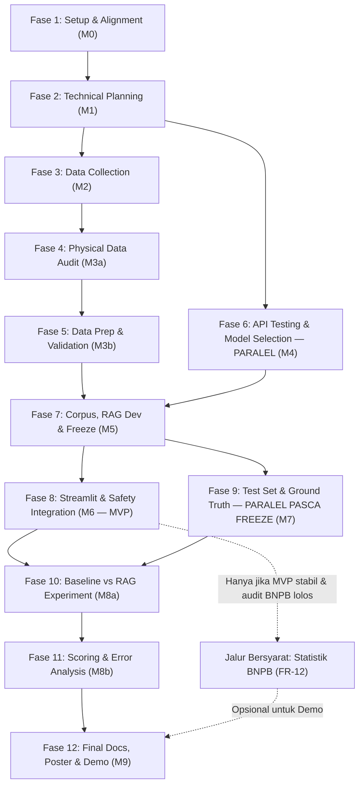

# Team Workflow & Execution Plan — SiagaBanjir

## A. Document Overview

> **Judul Proyek:** SiagaBanjir *(Judul akademik final: Open Decision `OD-01`)*  
> **Status Dokumen:** Draft v0.5 *(Revisi Pembagian Peran Final & Sinkronisasi Git Bootstrap)*  
> **Tanggal Pembuatan:** 24 November 2026  
> **Tim:** 2 mahasiswa — **Member A (Syahir)** & **Member B (Ramadan)**  
> **Referensi Utama:** [PRD.md](./PRD.md) (Draft v0.3 — *Source of Truth*)  
> **Repository GitHub:** [Syahirmr/SiagaBanjir](https://github.com/Syahirmr/SiagaBanjir)  
> **Domain:** Mitigasi Bencana — Edukasi Kesiapsiagaan Banjir *(Disetujui dosen)*

**Tujuan dan Fungsi Dokumen:**  
Dokumen ini adalah pedoman eksekusi operasional proyek Big Project Sains Data **SiagaBanjir**. Setiap unit kerja dirancang agar menjawab lima pertanyaan pokok secara terukur:
1. **Mengapa** pekerjaan tersebut dilakukan (tujuan dan keterkaitan dengan [PRD.md](./PRD.md));
2. **Apa** aktivitas konkret yang dikerjakan secara berurutan;
3. **Siapa** penanggung jawab utama (PIC) dan pemeriksanya (*reviewer*);
4. **Apa output** nyata (file, laporan, log, atau artefak uji) yang wajib dihasilkan;
5. **Bagaimana membuktikan** pekerjaan telah selesai secara objektif (*Definition of Done* dan *Exit Gate*).

**Hubungan dengan Dokumen Proyek Lainnya:**  
Dokumen ini menerjemahkan kebutuhan *apa* dan *mengapa* dari [PRD.md](./PRD.md) (Draft v0.3) menjadi urutan kerja, pembagian kepemilikan, strategi Git, milestone, serta ID tugas yang langsung dilacak pada [TODO.md](./TODO.md) dan menjadi acuan bagi dokumen teknis yang direncanakan ([ARCHITECTURE.md](./ARCHITECTURE.md), [DATA_DICTIONARY.md](./DATA_DICTIONARY.md), [EVALUATION_PLAN.md](./EVALUATION_PLAN.md)). Tata kelola lengkap antar-dokumen dijelaskan pada Bagian I.

---

## B. Project Execution Principles

Kedua anggota tim menyepakati delapan prinsip pelaksanaan berikut sepanjang proyek:

1. **Documentation-First:** Setiap tahap desain, audit data, konfigurasi API, dan evaluasi diawali dan ditutup dengan dokumentasi ringkas agar keputusan dapat ditelusuri ulang.
2. **MVP-First:** Seluruh kebutuhan `Must` (`FR-01` s.d. `FR-11`), evaluasi komparatif 30 pertanyaan, dan Poster Ilmiah diprioritaskan hingga tuntas sebelum menyentuh fitur tambahan bersyarat (Statistik BNPB `FR-12` atau *multi-turn* `FR-13`).
3. **Milestone-Driven Development:** Kemajuan proyek diukur melalui pencapaian *Exit Gate* milestone (`M0`–`M9`), bukan sekadar keberadaan berkas kode atau catatan aktivitas. Tidak ada milestone yang ditandai `Completed` sebelum bukti hasil diverifikasi.
4. **Clear Ownership:** Setiap tugas memiliki tepat satu PIC utama untuk mencegah pekerjaan ganda atau tidak bertuan, sementara tugas kritis tertentu dikerjakan secara kolaboratif bersama.
5. **Cross-Review Antaranggota:** Setiap artefak yang menjadi masukan bagi anggota lain wajib ditinjau (*cross-review*) terlebih dahulu sebelum *handoff* dinyatakan sah.
6. **Data Integrity:** Tidak ada dokumen atau dataset yang digunakan sebelum lolos pengumpulan resmi, verifikasi metadata, dan *physical audit*. Korpus wajib melalui *corpus versioning* dan *corpus freeze* sebelum evaluasi final.
7. **Reproducible Experiments:** Setiap pengujian LLM (*Baseline* maupun *RAG*) wajib mencatat `provider`, `model_id`, `corpus_version`, `source_dates`, dan parameter terkendali. Hasil eksperimen tidak pernah diasumsikan sebelum pengujian aktual dijalankan.
8. **Scope Control:** Perubahan kebutuhan, ruang lingkup, komposisi 30 pertanyaan uji, atau arsitektur inti **tidak boleh dilakukan secara sepihak**. Setiap perubahan penting wajib disepakati kedua anggota dan diperbarui terlebih dahulu di [PRD.md](./PRD.md).

---

## C. Team Structure & Responsibility

Pembagian peran berikut merupakan *ownership* awal untuk memastikan akuntabilitas jelas dan beban kerja teknis maupun dokumentasi relatif seimbang bagi tim beranggotakan 2 mahasiswa. Kepemilikan ini **bukan larangan untuk saling membantu** apabila terjadi hambatan pada salah satu jalur.

### C.1 Profil Kepemilikan Peran *(Revisi Final)*

- **Member A (Syahir) — LLM & Application Engineering** *(Branch pribadi: `syahir`)*  
  Memimpin desain arsitektur RAG (`ARCHITECTURE.md`), protokol keselamatan darurat & skema *logging* (`WF-004`, `WF-006`), pengujian Gemini API (utama) dan Groq API (cadangan), pemilihan model spesifik berdasarkan tes aktual (`WF-015`–`WF-017`), integrasi RAG dengan LangChain secara selektif serta jalur *Baseline* (`WF-019`–`WF-020`), pengembangan antarmuka Streamlit lokal, kontrol keselamatan, *error handling*, dan *logging* (`WF-022`–`WF-025`), serta eksekusi eksperimen *Baseline* vs *RAG* (`WF-030`–`WF-031`).
- **Member B (Ramadan) — Data & Knowledge Preparation** *(Branch pribadi: `ramadan`)*  
  Memimpin kontrak skema metadata korpus (`WF-005`), pengumpulan dokumen resmi, verifikasi sumber & metadata, *physical audit* dokumen dan kandidat dataset BNPB (`WF-007`–`WF-011` — meninjau & melanjutkan draf awal di [DATA_DICTIONARY.md](./DATA_DICTIONARY.md)), ekstraksi teks, *data cleaning* & *spot-check*, finalisasi `DATA_DICTIONARY.md` (`WF-012`–`WF-014`), *chunking* & `corpus_manifest` berversi (`WF-018`, dengan koordinasi integrasi bersama Syahir), serta QA independen lintas perangkat atas MVP Streamlit (`WF-026`).
- **Tanggung Jawab Bersama (Member A & Member B)** *(Integrasi ke `master` melalui Pull Request & review silang)*  
  Penutupan fondasi `M0` (`WF-001`–`WF-003`), keputusan desain penting, *cross-review* hasil data dan aplikasi, verifikasi kualitas *retrieval* & *corpus freeze* (`WF-021`), penyusunan bersama 30 pertanyaan uji, kasus darurat, *ground truth*, dan rubrik (`WF-027`–`WF-029`), penilaian respons secara independen, rekonsiliasi skor, dan *error analysis* (`WF-032`–`WF-034`), integrasi akhir, gladi demonstrasi lokal, dokumentasi final, serta Poster Ilmiah (`WF-035`–`WF-038`).

### C.2 Tabel Pembagian Tanggung Jawab

| Area Kerja | PIC Utama | Reviewer | Output Utama | Batas Tanggung Jawab |
|---|---|---|---|---|
| **Alignment, Git Workflow & Tata Kelola** | Bersama (Koordinasi: Syahir) | Kedua anggota | `TEAM_WORKFLOW.md`, [TODO.md](./TODO.md), `.gitignore`, log keputusan | Perubahan scope wajib persetujuan bersama & update `PRD.md`; integrasi ke `master` wajib lewat PR & review (lihat Bagian M). |
| **Desain Arsitektur, Safety & Kontrak Data** | Syahir (Arsitektur/Safety/Log) & Ramadan (Kontrak Metadata) | Silang (A ↔ B) | `ARCHITECTURE.md` (*planned*), kontrak skema metadata di `DATA_DICTIONARY.md`, desain prompt & log | Fokus pada RAG utama + LangChain selektif; tidak membangun *agent* kompleks. |
| **Pengumpulan, Verifikasi & Audit Fisik Data** | Ramadan *(meninjau draf awal Syahir)* | Syahir | Daftar sumber terverifikasi, laporan *physical audit*, [DATA_DICTIONARY.md](./DATA_DICTIONARY.md) | Hanya sumber resmi yang lolos audit fisik yang boleh masuk korpus; statistik BNPB hanya diaudit kelayakannya dulu. |
| **Ekstraksi, Cleaning, Chunking & Corpus Freeze** | Ramadan (`WF-012`–`WF-014`, `WF-018`) & Bersama (`WF-021`) | Syahir | Korpus bersih ber-metadata, *chunk* + `corpus_manifest` berversi, artefak *corpus freeze* | `WF-018` milik Ramadan dengan koordinasi integrasi bersama Syahir; tidak mengubah korpus setelah *freeze*. |
| **Tes API & Pemilihan Model** | Syahir | Ramadan | Laporan hasil tes Gemini API & Groq API, konfigurasi `.env.example`, keputusan `OD-02` | Tidak mengunci nama model sebelum bukti tes API aktual; API key dilarang masuk Git. |
| **Implementasi RAG, Baseline, Safety & Logging** | Syahir | Ramadan | Modul *retrieval*, RAG & *Baseline*, protokol respons darurat (`FR-07`), *logger* (`FR-11`) | Wajib memakai korpus *frozen* dari Ramadan dan mempertahankan sitasi metadata asli. |
| **Antarmuka Streamlit Lokal, Error Handling & QA** | Syahir (Implementasi UI/Error) & Ramadan (Uji Fungsional & Lintas Perangkat) | Silang (A ↔ B) | Aplikasi Streamlit lokal siap demo (`FR-01`, `FR-09`, `FR-10`), laporan QA lintas perangkat | Demonstrasi lokal saja; pengujian independen oleh Ramadan mencegah *self-review* tunggal. |
| **Dataset Uji 30 Soal & Ground Truth** | Bersama (Koord Rubrik: Ramadan) | Silang (A ↔ B) | `EVALUATION_PLAN.md` (*planned*), 30 pertanyaan uji + *ground truth*, kasus uji darurat | Komposisi 10+10+5+5 tidak diubah tanpa update PRD; rubrik final (`OD-05`) disepakati sebelum penilaian. |
| **Eksperimen Baseline vs RAG & Penilaian** | Bersama (Eksekusi: Syahir; Audit Log/Korpus: Ramadan) | Independen (A & B) | Log eksekusi Baseline & RAG, skor independen A & B, hasil rekonsiliasi & *error analysis* | Provider, model, parameter, dan 30 pertanyaan harus identik untuk kedua kondisi; penilaian awal dilakukan terpisah. |
| **Dokumentasi Akhir, Demo & Poster Ilmiah** | Bersama (Op Demo: Syahir; Verif: Ramadan) | Kedua anggota | Laporan/dokumentasi lengkap, gladi demo Streamlit, Poster Ilmiah 5 komponen wajib | Poster wajib memuat hasil evaluasi aktual Baseline vs RAG, bukan promosi fitur. |

### C.3 Ringkasan Keseimbangan Beban Kerja & Mekanisme Cross-Review
Dari 38 tugas inti (`WF-001`–`WF-038`), kepemilikan terbagi seimbang sesuai peran final: **Member A (Syahir — LLM & App)** menjadi PIC tunggal pada **13 tugas** (`WF-004`, `WF-006`, `WF-015`–`WF-017`, `WF-019`–`WF-020`, `WF-022`–`WF-025`, `WF-030`–`WF-031`), **Member B (Ramadan — Data & Knowledge)** menjadi PIC tunggal pada **11 tugas** (`WF-005`, `WF-007`–`WF-014`, `WF-018` dengan koordinasi integrasi bersama Syahir, serta QA independen `WF-026`), dan **14 tugas kolaboratif bersama** (`WF-001`–`WF-003`, `WF-021`, `WF-027`–`WF-029`, `WF-032`–`WF-038`). Artefak audit awal [DATA_DICTIONARY.md](./DATA_DICTIONARY.md) tetap dipertahankan utuh untuk ditinjau dan dilanjutkan oleh Ramadan.

**Mekanisme Cross-Review dan Handoff:**
1. **Prasyarat Pengajuan Review:** PIC memastikan seluruh kriteria *Definition of Done* tugas terpenuhi dan artefak tersimpan pada lokasi yang disepakati.
2. **Pemeriksaan Reviewer:** Anggota lain memeriksa kelengkapan, kesesuaian dengan [PRD.md](./PRD.md), dan keterpakaian artefak untuk tahap berikutnya (maksimal 1 siklus klarifikasi cepat).
3. **Persetujuan Handoff:** Jika memenuhi syarat, reviewer memberi persetujuan pada Pull Request (lihat Bagian M) dan catatan progres di [TODO.md](./TODO.md) lalu status tugas berubah ke `Completed`. Jika belum memenuhi syarat, item ditandai untuk perbaikan spesifik sebelum berpindah fase.

---

## D. End-to-End Project Pipeline

### D.1 Peta Aliran Pipeline dan Jalur Paralel



> **Catatan Penjadwalan (Estimasi Awal & Sprint 7 Hari — Bukan Deadline Resmi):**  
> Karena tanggal UAS belum ditetapkan dalam konteks dokumen ini, setiap fase dilengkapi **estimasi durasi relatif dalam satuan sesi kerja** *(1 sesi ≈ 2–3 jam kerja fokus)*, sedangkan jadwal operasional paralel **Hari 1–7** (target MVP + evaluasi 30 soal + Poster Ilmiah) dirinci pada [TODO.md](./TODO.md) Bagian 2. Keduanya bersifat target relatif (bukan deadline kalender resmi) dan fleksibel terhadap revisi dosen.

---

### Fase 1 — Project Setup & Documentation Alignment *(Estimasi awal: 1–2 sesi)*
1. **Tujuan fase:** Menyelaraskan pemahaman kedua anggota terhadap [PRD.md](./PRD.md) v0.3, mengunci tata kerja tim & aturan Git branching, menyiapkan pelacak [TODO.md](./TODO.md), serta memastikan keamanan kredensial `.env` dan konvensi folder sebelum masuk ke desain teknis.
2. **Aktivitas:**
   - Meninjau ulang seluruh isi [PRD.md](./PRD.md) v0.3 bersama dan mengonfirmasi keputusan final vs 5 *Open Decisions*.
   - Menyetujui [TEAM_WORKFLOW.md](./TEAM_WORKFLOW.md) termasuk pembagian kepemilikan awal Member A (Syahir) & Member B (Ramadan) serta strategi Git (`master`, `syahir`, `ramadan` pada Bagian M).
   - Menyiapkan pelacak tugas [TODO.md](./TODO.md) berbasis seluruh 42 Work ID dan Milestone ID (`M0`–`M9`, `M-OPT`).
   - Mendokumentasikan konvensi struktur folder (`docs/`, `data/raw/`, `data/processed/`), memverifikasi `.gitignore` (`.env`, `.env.*`, `!.env.example`, `.streamlit/secrets.toml`, `venv/`), serta memverifikasi inisialisasi branch lokal/remote di [Syahirmr/SiagaBanjir](https://github.com/Syahirmr/SiagaBanjir).
3. **PIC dan reviewer:** Bersama (Koordinasi: Member A; Review silang: Member B).
4. **Input/dependensi:** [PRD.md](./PRD.md) (Draft v0.3) dan domain yang sudah disetujui dosen.
5. **Output/deliverables:** [TEAM_WORKFLOW.md](./TEAM_WORKFLOW.md) v0.5 (memuat pembagian peran final, Git branching strategy & konvensi folder), [TODO.md](./TODO.md) (42 Work ID), `.gitignore` aman di root, serta verifikasi status branch `master`, `syahir`, dan `ramadan`.
6. **Definition of Done:** Seluruh dokumen & konfigurasi keamanan M0 tersedia dan terverifikasi, branch Git aktif sesuai strategi, serta **kedua anggota (Syahir dan Ramadan)** mencatat persetujuan eksplisit atas `PRD.md` v0.3 dan `TEAM_WORKFLOW.md` v0.5.
7. **Exit Gate (`M0`):** `PRD.md` v0.3 dan `TEAM_WORKFLOW.md` v0.5 disetujui secara eksplisit oleh Member A (Syahir) dan Member B (Ramadan), `TODO.md` memuat 42 Work ID sinkron, `.gitignore` melindungi `.env`/`.streamlit/secrets.toml`, dan branch `master`, `syahir`, `ramadan` siap digunakan.
8. **Risiko dan tindakan jika gagal:** Jika `.git` lokal belum terhubung ke remote atau persetujuan salah satu anggota belum tercatat, pertahankan status `M0` sebagai `In Progress` (*Awaiting Team Approval*) dan selesaikan instruksi setup manual pada Bagian M.4 sebelum masuk ke `M1`.

### Fase 2 — Technical Planning & Architecture Design *(Estimasi awal: 2 sesi)*
1. **Tujuan fase:** Merancang arsitektur RAG, kontrak format data *handoff*, strategi *retrieval*, pemakaian LangChain selektif, serta desain *safety* dan *logging* sebelum implementasi kode.
2. **Aktivitas:**
   - Menyusun `ARCHITECTURE.md` (*planned*) mencakup alur *end-to-end* Streamlit → *retriever* → LangChain selektif → Gemini/Groq API → respons bersitasi.
   - Mendefinisikan kontrak skema *chunk* dan metadata korpus (ID dokumen, instansi, tanggal sumber, tanggal ambil, halaman/bagian) agar kompatibel antara pekerjaan Member A dan Member B.
   - Merancang spesifikasi *system prompt* (grounding, *abstention*, klarifikasi ambigu, dan **protokol respons khusus situasi darurat** `FR-07`).
   - Merancang skema log *reproducibility* (`FR-11`: `provider`, `model_id`, `corpus_version`, `source_dates`, konteks, jawaban, sitasi, status, latensi) dan rancangan mode *Baseline* vs *RAG*.
3. **PIC dan reviewer:** PIC: Member A / Syahir (Arsitektur, *Safety* & Log) & Member B / Ramadan (Kontrak Skema Metadata) | Reviewer: Silang (A ↔ B).
4. **Input/dependensi:** `M0` selesai; [PRD.md](./PRD.md) Bagian 7–12.
5. **Output/deliverables:** `ARCHITECTURE.md` (*planned*), spesifikasi kontrak metadata korpus di [DATA_DICTIONARY.md](./DATA_DICTIONARY.md), rancangan skema log evaluasi dan protokol keselamatan.
6. **Definition of Done:** Seluruh kebutuhan `FR-01` s.d. `FR-11` terpetakan ke komponen teknis nyata tanpa memasukkan *agent* kompleks atau fitur di luar MVP.
7. **Exit Gate (`M1`):** `ARCHITECTURE.md` disetujui bersama; Member B (Ramadan) memiliki kontrak skema data yang jelas untuk mulai kurasi, dan Member A (Syahir) memiliki spesifikasi uji API untuk mulai Fase 6 secara paralel.
8. **Risiko dan tindakan jika gagal:** Jika desain terlalu kompleks untuk 2 orang (mis. terlalu banyak lapisan LangChain), pangkas ke alur RAG paling sederhana yang tetap memenuhi seluruh FR wajib.

### Fase 3 — Data Collection & Source Verification *(Estimasi awal: 2–3 sesi)*
1. **Tujuan fase:** Mengumpulkan kandidat dokumen edukasi kesiapsiagaan banjir resmi Indonesia (serta kandidat statistik BNPB secara terpisah bila tersedia) dan memverifikasi keabsahan sumber sebelum audit fisik.
2. **Aktivitas:**
   - Mengidentifikasi dan mengumpulkan kandidat dokumen edukasi kebencanaan resmi Indonesia (BNPB, BPBD, BMKG edukatif, atau instansi resmi terkait) mencakup fase sebelum, saat, dan setelah banjir (cakupan umum Indonesia).
   - Mencatat metadata awal setiap berkas: `source_id`, judul, instansi penerbit, tanggal/tahun publikasi (`source_date`), URL/lokasi asal, tanggal pengambilan (`retrieved_date`), dan format berkas.
   - Memverifikasi keabsahan sumber (instansi resmi, dapat dipakai untuk tujuan akademik, relevansi domain banjir).
   - Memisahkan kandidat dataset statistik BNPB ke kategori khusus bersyarat (`FR-12`) tanpa mencampurkannya ke korpus teks MVP.
3. **PIC dan reviewer:** PIC: Member B (Ramadan) | Reviewer: Member A (Syahir).
4. **Input/dependensi:** `M1` selesai (kontrak metadata korpus); [PRD.md](./PRD.md) Bagian 11.
5. **Output/deliverables:** Inventaris kandidat sumber terverifikasi (tabel metadata awal) dan repositori berkas mentah terorganisir sesuai konvensi.
6. **Definition of Done:** Seluruh tiga fase banjir (sebelum, saat, setelah) memiliki kandidat dokumen resmi terverifikasi dengan metadata minimal lengkap (`source_date` dan `retrieved_date` tercatat).
7. **Exit Gate (`M2`):** Member A (Syahir) memverifikasi kelengkapan metadata dan ketercakupan 3 fase banjir; tidak ada sumber anonim atau tidak terverifikasi yang diteruskan ke audit fisik.
8. **Risiko dan tindakan jika gagal:** Jika dokumen resmi tertentu tidak dapat diakses atau tautan rusak, cari publikasi resmi alternatif dari instansi pemerintah/lembaga kebencanaan lain dan catat ketidaksediaannya secara transparan.

### Fase 4 — Physical Data Audit *(Estimasi awal: 2 sesi)*
1. **Tujuan fase:** Memeriksa kondisi fisik berkas mentah secara nyata (keterbacaan teks PDF, struktur halaman, kualitas tabel/dataset) sehingga tidak ada data rusak yang masuk ke basis pengetahuan.
2. **Aktivitas:**
   - Menguji keterbacaan dan kelayakan ekstraksi teks seluruh kandidat dokumen edukasi (mendeteksi PDF hasil *scan* rusak, karakter acak, halaman hilang, atau struktur terpotong).
   - Menilai kesesuaian isi terhadap cakupan umum Indonesia dan mencatat jika suatu dokumen hanya berlaku untuk wilayah tertentu.
   - Jika kandidat dataset statistik BNPB tersedia, menjalankan audit fisik skema: pemeriksaan *header*, tipe data, *missing values*, duplikasi, definisi indikator/satuan, periode, dan konsistensi nilai total.
   - Menyusun keputusan kelayakan (*Layak / Perlu Pembersihan / Ditolak*) untuk setiap berkas beserta alasannya.
3. **PIC dan reviewer:** PIC: Member B (Ramadan) | Reviewer: Member A (Syahir).
4. **Input/dependensi:** `M2` selesai (berkas mentah & inventaris metadata awal).
5. **Output/deliverables:** Laporan hasil *Physical Data Audit* pada [DATA_DICTIONARY.md](./DATA_DICTIONARY.md) berisi status kelayakan tiap sumber (termasuk rekomendasi kelayakan statistik BNPB).
6. **Definition of Done:** Setiap berkas kandidat memiliki status audit fisik terdokumentasi dan bukti hasil pemeriksaan ekstraksi/struktur aktual.
7. **Exit Gate (bagian dari `M3`):** Terdapat cukup dokumen edukasi berstatus *Layak* untuk mencakup fase sebelum, saat, dan setelah banjir; berkas rusak disingkirkan dari jalur MVP.
8. **Risiko dan tindakan jika gagal:** Jika terlalu banyak PDF berupa *scan* tidak terbaca, kembali ke Fase 3 untuk mengganti dengan dokumen digital resmi lain (bukan membangun *pipeline* OCR skala besar). Jika data BNPB gagal audit fisik, fitur `FR-12` resmi ditangguhkan dari demonstrasi dan dicatat alasannya.

### Fase 5 — Data Preparation & Quality Validation *(Estimasi awal: 2–3 sesi)*
1. **Tujuan fase:** Mengubah dokumen edukasi yang lulus audit fisik menjadi korpus teks bersih, terstruktur, dan siap diindeks dengan metadata sitasi yang utuh.
2. **Aktivitas:**
   - Mengekstrak teks dokumen edukasi yang lulus audit fisik sambil mempertahankan nomor halaman/judul bagian untuk kebutuhan sitasi (`FR-04`).
   - Membersihkan artefak ekstraksi (header/footer berulang, spasi rusak, karakter non-standar) tanpa mengubah makna prosedur keselamatan.
   - Melakukan validasi kualitas acak (*spot-check*) perbandingan teks bersih terhadap dokumen asli guna memastikan tidak ada prosedur penting yang hilang atau terbalik.
   - Melengkapi `DATA_DICTIONARY.md` (*planned*) dengan skema teks terproses, daftar sumber final sementara (`OD-03`), dan catatan keterbatasan setiap dokumen.
3. **PIC dan reviewer:** PIC: Member B (Ramadan) | Reviewer: Member A (Syahir).
4. **Input/dependensi:** Laporan *Physical Data Audit* (Fase 4); kontrak metadata dari `ARCHITECTURE.md` (`M1`).
5. **Output/deliverables:** Kumpulan teks edukasi bersih ber-metadata, laporan hasil validasi kualitas teks, dan [DATA_DICTIONARY.md](./DATA_DICTIONARY.md) final untuk korpus edukasi.
6. **Definition of Done:** Seluruh dokumen yang masuk daftar terpilih terekstrak bersih, metadata lengkap (termasuk `source_date` dan penanda halaman/bagian), dan lulus *spot-check* oleh Member A (Syahir).
7. **Exit Gate (`M3`):** Korpus teks bersih siap diserahkan (*handoff*) ke Member A (Syahir) untuk integrasi indeks RAG; daftar sumber data final (`OD-03`) terkunci pada level dokumen edukasi.
8. **Risiko dan tindakan jika gagal:** Jika *spot-check* menemukan bagian penting terpotong atau sitasi halaman meleset, perbaiki skrip ekstraksi/cleaning untuk dokumen terkait sebelum diserahkan ke Fase 7.

### Fase 6 — API Testing & Model Selection *(Jalur Paralel dengan Fase 3–5 | Estimasi awal: 1–2 sesi)*
1. **Tujuan fase:** Memverifikasi konektivitas nyata Gemini API (utama) dan Groq API (cadangan), menguji kuota, latensi, dan kualitas Bahasa Indonesia secara aktual, lalu menetapkan model spesifik (`OD-02`).
2. **Aktivitas:**
   - Menyiapkan pengelolaan kredensial aman berbasis `.env` (dipastikan tercantum di `.gitignore`) dan template `.env.example`.
   - Menjalankan skrip uji API terhadap kandidat model pada **Gemini API** dan **Groq API** menggunakan beberapa contoh pertanyaan kebencanaan berbahasa Indonesia.
   - Mencatat bukti aktual per kandidat model: ketersediaan endpoint, batas kuota/rate limit, stabilitas respons, latensi rata-rata, dan kejelasan Bahasa Indonesia.
   - Menetapkan model spesifik utama (Gemini), model cadangan (Groq), dan konfigurasi parameter terkendali (mis. *temperature*, batas token) serta mekanisme *fallback* saat error (`FR-09`).
3. **PIC dan reviewer:** PIC: Member A (Syahir) | Reviewer: Member B (Ramadan).
4. **Input/dependensi:** `M1` selesai (`ARCHITECTURE.md` *planned*); akun/API key uji lokal tim. *(Tidak bergantung pada selesainya Fase 3–5 sehingga aman dijalankan paralel.)*
5. **Output/deliverables:** Laporan hasil tes API (Gemini & Groq), konfigurasi model & parameter terkendali (menutup `OD-02`), serta modul konektor LLM terverifikasi.
6. **Definition of Done:** Gemini API dan Groq API terbukti merespons secara nyata, pemilihan model spesifik didukung data tes aktual (bukan asumsi), dan tidak ada API key yang tersimpan di kode sumber.
7. **Exit Gate (`M4`):** Keputusan model spesifik (`OD-02`) disetujui bersama dan siap digunakan secara identik pada pengembangan RAG (Fase 7) maupun eksperimen *Baseline* vs *RAG* (Fase 10).
8. **Risiko dan tindakan jika gagal:** Jika model kandidat utama mengalami pembatasan kuota ketat atau error berulang, pilih model alternatif yang stabil pada Gemini API atau siapkan protokol peralihan cepat ke Groq API cadangan dan dokumentasikan pada laporan tes API.

### Fase 7 — Corpus Preparation, RAG Development & Corpus Freeze *(Estimasi awal: 3–4 sesi)*
1. **Tujuan fase:** Membangun *chunking*, indeks *retrieval*, dan *pipeline* RAG dengan LangChain secara selektif, memverifikasi kualitas konteks & sitasi, lalu membekukan versi korpus (*corpus freeze*) sebelum evaluasi.
2. **Aktivitas:**
   - Melakukan *chunking* dokumen bersih hasil `M3` dengan mempertahankan metadata sumber (`source_id`, judul, instansi, `source_date`, `retrieved_date`, halaman/bagian) dan menyusun *corpus manifest* berversi (mis. `corpus_v1.0`).
   - Membangun indeks pencarian dan *pipeline* RAG (retrieval → *system prompt* grounded & sitasi → panggilan Gemini API via LangChain selektif) serta dukungan cadangan Groq API.
   - Mengimplementasikan jalur **Baseline LLM tanpa *retrieval*** (menggunakan provider, model, dan parameter terkendali yang sama) untuk kesiapan eksperimen pembanding.
   - Melakukan uji coba kualitas *retrieval* internal bersama (Member A & Member B) untuk memeriksa apakah potongan konteks yang diambil relevan dan sitasinya cocok dengan dokumen asli.
   - Melakukan ***corpus freeze***: mengunci versi korpus (mis. `corpus_v1.0-frozen`) beserta *manifest* lengkap sehingga korpus tidak lagi diubah selama tahap evaluasi.
3. **PIC dan reviewer:** PIC: Member A / Syahir (RAG, *Baseline* & indeks) bersama Member B / Ramadan (*chunking*/manifest `WF-018` dengan koordinasi integrasi bersama Syahir, *corpus versioning* & validasi konteks) | Reviewer: Silang (A ↔ B).
4. **Input/dependensi:** `M3` selesai (korpus teks bersih) **dan** `M4` selesai (model API tervalidasi).
5. **Output/deliverables:** *Pipeline* RAG dan mode *Baseline* berjalan *end-to-end*, indeks korpus *frozen*, `corpus_manifest` berversi (`v1.0-frozen`), serta log uji coba internal kualitas *retrieval* & sitasi.
6. **Definition of Done:** RAG mengambil konteks relevan dari korpus *frozen*, menghasilkan jawaban Bahasa Indonesia dengan sitasi yang cocok terhadap konteks terambil, mode *Baseline* siap dijalankan dengan model identik, dan *corpus freeze* tercatat resmi.
7. **Exit Gate (`M5`):** Kedua anggota menandatangani persetujuan *corpus freeze* dan memverifikasi bahwa RAG operasional secara nyata (bukan sekadar keberadaan file kode).
8. **Risiko dan tindakan jika gagal:** Jika *retrieval* sering mengambil potongan tidak relevan, evaluasi ulang ukuran *chunk*, *overlap*, atau strategi pencarian sebelum *corpus freeze* dilakukan. Perubahan setelah *freeze* hanya boleh dilakukan dengan menaikkan nomor versi korpus dan mengulang penyelarasan evaluasi.

### Fase 8 — Streamlit Integration & Safety Implementation *(Estimasi awal: 2–3 sesi)*
1. **Tujuan fase:** Mengintegrasikan *pipeline* RAG ke antarmuka Streamlit lokal yang ramah pengguna non-ahli, menerapkan seluruh kontrol keselamatan (`FR-05`, `FR-07`, `FR-08`), *error handling* (`FR-09`), transparansi UI (`FR-10`), dan *logging* (`FR-11`).
2. **Aktivitas:**
   - Membangun antarmuka chat **Streamlit lokal** dengan input/output bersih, indikator pemrosesan, penanganan input kosong (`FR-01`), dan panel informasi/disclaimer keselamatan permanen serta tampilan versi korpus aktif (`FR-10`).
   - Mengimplementasikan **protokol respons khusus situasi darurat akut** dan penolakan prediksi/peringatan dini (`FR-07`), *abstention* untuk *out-of-scope*/klaim wilayah tanpa sumber (`FR-05`), serta permintaan klarifikasi untuk pertanyaan ambigu (`FR-08`).
   - Mengimplementasikan *error handling* terkendali (`FR-09`: API timeout, kuota habis, indeks kosong) dan sakelar/konfigurasi *fallback* ke Groq API tanpa membocorkan kredensial atau *stack trace*.
   - Mengimplementasikan modul pencatatan (*logging*) terstruktur (`FR-11`) yang merekam `provider`, `model_id`, `corpus_version`, `source_dates`, konteks terambil, jawaban, sitasi, status API, dan waktu respons.
   - Melakukan uji fungsional *end-to-end* lokal termasuk *negative testing* (input kosong, simulasi API gagal, pertanyaan darurat akut, pertanyaan di luar domain).
3. **PIC dan reviewer:** PIC: Member A / Syahir (Implementasi UI, *Safety*, *Error Handling* & *Logging*) & Member B / Ramadan (Uji Fungsional, *Negative Testing* & Verifikasi Lintas Perangkat) | Reviewer: Silang (A ↔ B).
4. **Input/dependensi:** `M5` selesai (RAG operasional & korpus *frozen*).
5. **Output/deliverables:** Aplikasi Streamlit lokal MVP berfungsi penuh, skrip/modul *logging* evaluasi, serta laporan hasil uji fungsional & *negative testing* MVP.
6. **Definition of Done:** Seluruh kebutuhan `FR-01` s.d. `FR-11` lulus uji fungsional pada perangkat lokal kedua anggota tanpa *crash* dan menampilkan sitasi serta *disclaimer* dengan benar.
7. **Exit Gate (`M6` — MVP Chatbot Functional):** Prototipe MVP siap didemonstrasikan secara lokal di Streamlit dan siap memasuki tahap evaluasi formal. *(Gerbang keputusan apakah Jalur Bersyarat Statistik BNPB boleh dipertimbangkan dibuka setelah tahap ini.)*
8. **Risiko dan tindakan jika gagal:** Jika integrasi Streamlit bermasalah (*state* hilang, pemuatan indeks berulang terlalu lambat), gunakan *caching* sumber daya Streamlit dan uji ulang sebelum masuk ke evaluasi.

### Fase 9 — Test Dataset & Ground Truth Preparation *(Dapat Paralel dengan Fase 8 Pasca-`M5` | Estimasi awal: 2 sesi)*
1. **Tujuan fase:** Menyusun dataset uji evaluasi yang adil, representatif, dan terverifikasi terhadap korpus *frozen*, beserta rubrik penilaian sebelum eksperimen pembanding dijalankan.
2. **Aktivitas:**
   - Menyusun **tepat 30 pertanyaan uji** berdasarkan korpus *frozen* sesuai komposisi PRD: **10 faktual, 10 prosedural, 5 di luar cakupan (*out-of-scope*), dan 5 ambigu**.
   - Menyusun secara terpisah daftar **kasus uji verifikasi keselamatan darurat** (situasi darurat akut & permintaan prediksi/peringatan dini) untuk menguji `FR-07`.
   - Menyusun *ground truth* bersama (Member A & Member B): poin kunci jawaban, `sumber_acuan` resmi dari korpus *frozen*, dan `ekspektasi_perilaku`.
   - Menyepakati detail rubrik penilaian, skala skor, ambang evaluasi, dan aturan rekonsiliasi penilaian independen (`OD-05`), lalu mendokumentasikannya dalam `EVALUATION_PLAN.md` (*planned*).
3. **PIC dan reviewer:** Bersama (Member A & Member B) dengan pemeriksaan silang atas seluruh rujukan dokumen asli.
4. **Input/dependensi:** `M5` selesai (korpus *frozen* & manifest); [PRD.md](./PRD.md) Bagian 12. *(Tidak perlu menunggu selesainya antarmuka Streamlit `M6` sehingga penyusunan dapat berjalan paralel dengan Fase 8, lalu dikunci sebelum Fase 10.)*
5. **Output/deliverables:** `EVALUATION_PLAN.md` (*planned*), file dataset 30 pertanyaan uji + *ground truth*, daftar kasus uji keselamatan darurat, dan rubrik penilaian final (`OD-05`).
6. **Definition of Done:** Seluruh 30 pertanyaan + kasus darurat memiliki *ground truth* terverifikasi dari korpus *frozen*, komposisi tepat 10+10+5+5, dan rubrik penilaian disepakati kedua anggota sebelum melihat hasil uji sistem.
7. **Exit Gate (`M7`):** Dataset uji, *ground truth*, dan rubrik penilaian terkunci (*locked*) sehingga eksperimen tidak bias terhadap output sistem.
8. **Risiko dan tindakan jika gagal:** Jika ditemukan pertanyaan faktual/prosedural yang ternyata jawabannya ambigu di korpus, revisi pertanyaan sebelum eksperimen dijalankan agar *ground truth* benar-benar objektif.

### Fase 10 — Baseline vs RAG Experiment *(Estimasi awal: 1–2 sesi)*
1. **Tujuan fase:** Menjalankan eksperimen pembanding terkontrol antara **Baseline LLM tanpa *retrieval*** dan **SiagaBanjir RAG** untuk menghasilkan log respons aktual yang dapat diaudit dan direproduksi.
2. **Aktivitas:**
   - Mengonfirmasi kesamaan variabel kontrol kedua kondisi: `provider` sama, `model_id` sama, konfigurasi parameter terkendali sama (mis. *temperature* dan batas token sesuai `OD-02`), dan kumpulan 30 pertanyaan uji identik.
   - Menjalankan **Kondisi A (Baseline LLM tanpa *retrieval*)** pada seluruh 30 pertanyaan uji dan menyimpan log lengkap (termasuk waktu respons dan status API).
   - Menjalankan **Kondisi B (SiagaBanjir RAG pada korpus *frozen*)** pada 30 pertanyaan uji yang sama dan menyimpan log lengkap (`provider`, `model_id`, `corpus_version`, `source_dates`, konteks terambil, jawaban, sitasi, latensi).
   - Menjalankan **kasus uji verifikasi keselamatan darurat** (`FR-07`, di luar komposisi 30 pertanyaan inti) pada sistem RAG dan menyimpan bukti respons aktualnya.
   - Memverifikasi integritas log (tidak ada pertanyaan terlewat, tidak ada kegagalan API yang tidak tercatat).
3. **PIC dan reviewer:** PIC Eksekusi: Member A (Syahir) | Verifikasi Kelengkapan Log & Korpus: Member B (Ramadan).
4. **Input/dependensi:** `M6` selesai (MVP & logger); `M7` selesai (30 soal uji + kasus darurat terkunci).
5. **Output/deliverables:** Log eksperimen mentah Kondisi A (*Baseline*), Kondisi B (*RAG*), dan uji keselamatan darurat lengkap dengan metadata *reproducibility*.
6. **Definition of Done:** Seluruh 30 pertanyaan menghasilkan respons terekam pada kedua kondisi dengan parameter terkendali yang identik, seluruh kasus darurat terekam, dan metadata *reproducibility* lengkap 100%.
7. **Exit Gate (bagian dari `M8`):** Kedua anggota memverifikasi keabsahan log eksperimen sebelum memulai tahap penilaian independen.
8. **Risiko dan tindakan jika gagal:** Jika kuota Gemini API habis di tengah eksperimen, jeda eksekusi sesuai *rate limit* atau — jika terpaksa beralih ke Groq API cadangan — jalankan ulang **kedua kondisi (Baseline dan RAG)** menggunakan model Groq yang sama agar perbandingan tetap adil dan valid.

### Fase 11 — Evaluation, Scoring & Error Analysis *(Estimasi awal: 2–3 sesi)*
1. **Tujuan fase:** Menilai kualitas respons secara objektif melalui penilaian independen dua anggota, merekonsiliasi perbedaan skor, dan menyusun analisis kesalahan (*error analysis*) nyata sebagai bahan dokumentasi dan Poster Ilmiah.
2. **Aktivitas:**
   - **Penilaian Independen:** Member A dan Member B menilai seluruh respons Kondisi A (*Baseline*) dan Kondisi B (*RAG*) secara terpisah menggunakan rubrik `EVALUATION_PLAN.md` (mencakup *Answer Correctness*, *Groundedness*, *Citation Accuracy*, *Relevance*, *Abstention & Clarification Quality*, ditambah evaluasi *Safety Compliance* pada kasus darurat dan rekap *Response Time*).
   - **Rekonsiliasi Nilai:** Membandingkan lembar skor Member A dan Member B, mencatat tingkat kesepakatan/perbedaan, dan menyelesaikan selisih penilaian berdasarkan bukti dokumen korpus *frozen*.
   - **Analisis Komparatif & Error Analysis:** Menyusun ringkasan metrik aktual Baseline vs RAG per kategori (faktual, prosedural, *out-of-scope*, ambigu), mengidentifikasi pola kegagalan (halusinasi, *retrieval miss*, sitasi meleset, *over-abstention*, latensi), serta mencatat keterbatasan aktual secara jujur.
3. **PIC dan reviewer:** Bersama (Penilaian independen oleh Member A dan Member B; kompilasi & tinjauan silang bersama).
4. **Input/dependensi:** Log eksperimen terverifikasi (Fase 10); rubrik & *ground truth* (`M7`).
5. **Output/deliverables:** Lembar penilaian independen Member A, lembar penilaian independen Member B, laporan rekonsiliasi & hasil evaluasi aktual Baseline vs RAG, serta dokumen *Error Analysis*.
6. **Definition of Done:** Seluruh 30 pertanyaan pada kedua kondisi + kasus darurat telah dinilai secara independen oleh kedua anggota, selisih telah direkonsiliasi berbasis bukti, dan ringkasan angka aktual + *error analysis* siap dijadikan bahan poster tanpa klaim yang melebihi data.
7. **Exit Gate (`M8`):** Laporan evaluasi komparatif aktual disetujui bersama dan terverifikasi konsisten terhadap log mentah (tidak ada angka estimasi/rekayasa).
8. **Risiko dan tindakan jika gagal:** Jika skor antar-penilai terlalu sering berbeda, tinjau kembali kejelasan definisi rubrik, dokumentasikan penyesuaian kriteria secara transparan, lalu lakukan kalibrasi ulang pada item yang berselisih.

### Fase 12 — Final Documentation, Poster & Demonstration *(Estimasi awal: 3 sesi)*
1. **Tujuan fase:** Menyelesaikan seluruh luaran akademik wajib Big Project: dokumentasi teknologi & alur kerja, **Poster Ilmiah** (5 komponen wajib berbasis hasil evaluasi aktual), dan kesiapan demonstrasi lokal Streamlit.
2. **Aktivitas:**
   - Menetapkan **judul akademik final** (`OD-01`) yang selaras dengan hasil proyek dan evaluasi.
   - Menyelesaikan dan menyinkronkan seluruh dokumentasi proyek (panduan menjalankan prototipe lokal, dokumentasi arsitektur, manifest korpus *frozen*, laporan evaluasi, dan *TODO* final).
   - Merancang dan menyusun **Poster Ilmiah** yang memuat lengkap 5 komponen wajib dosen: (1) Judul, latar belakang, tujuan & positioning; (2) Metodologi & pendekatan LLM/RAG; (3) Arsitektur/cara kerja chatbot; (4) **Hasil pengujian & evaluasi respons aktual (Baseline vs RAG + analisis kesalahan)**; (5) Kesimpulan & referensi resmi.
   - Melakukan uji reproduksibilitas lintas perangkat (menjalankan Streamlit lokal dari panduan dokumentasi di perangkat anggota lain) serta gladi bersih demonstrasi termasuk skenario pertanyaan baru/parafrase, darurat akut, dan *out-of-scope*.
3. **PIC dan reviewer:** Bersama (Penyusunan bersama; pemeriksaan silang keseluruhan luaran oleh kedua anggota).
4. **Input/dependensi:** `M6` selesai (MVP lokal); `M8` selesai (hasil evaluasi aktual); opsional jalur bersyarat BNPB jika telah lulus.
5. **Output/deliverables:** Dokumentasi proyek lengkap & tersinkronisasi, Poster Ilmiah final siap cetak/kumpul, panduan demo & skrip/daftar pertanyaan uji live, serta bukti kesiapan demo lokal Streamlit.
6. **Definition of Done:** Seluruh item pada *Final Completion Checklist* (Bagian L) terverifikasi terpenuhi; kedua anggota mampu mendemonstrasikan dan menjelaskan seluruh alur proyek secara mandiri.
7. **Exit Gate (`M9`):** Seluruh luaran akademik (Chatbot siap demo, Dokumentasi lengkap, Poster Ilmiah 5 komponen berbasis data aktual) lolos tinjauan akhir kedua anggota.
8. **Risiko dan tindakan jika gagal:** Jika waktu pengerjaan menipis menjelang pengumpulan, hentikan segera fitur opsional (`FR-12`/`FR-13`) dan pusatkan 100% kapasitas kedua anggota pada penyempurnaan Poster Ilmiah berbasis hasil evaluasi aktual dan stabilitas demo MVP.

---

### Jalur Tambahan Bersyarat — Statistik BNPB (`FR-12`, Opsional/Should) *(Estimasi awal: 2 sesi jika diaktifkan)*
> **Aturan Aktivasi Ketat:** Jalur ini **bukan MVP wajib**. Jalur ini **hanya dijalankan** apabila: (1) `M6` (MVP Chatbot Functional) selesai, (2) hasil *Physical Data Audit* (Fase 4) membuktikan dataset statistik BNPB layak secara struktur dan konsistensi, serta (3) pengerjaannya tidak mengganggu jadwal evaluasi 30 pertanyaan (`M7`–`M8`) dan Poster Ilmiah (`M9`).

1. **Tujuan jalur:** Menambahkan kemampuan demonstrasi eksplorasi statistik kejadian banjir BNPB secara deterministik dengan konteks wilayah, periode, dan batasan data yang benar.
2. **Aktivitas:**
   - Membersihkan dan memvalidasi dataset tabular BNPB yang telah lulus audit fisik (Pandas/openpyxl) serta mencatat skema dan keterbatasannya pada `DATA_DICTIONARY.md` (*planned*).
   - Mengimplementasikan modul komputasi statistik deterministik (agregasi wilayah/tahun oleh Python/Pandas, bukan hitungan bebas LLM) dengan narasi jawaban yang mencantumkan wilayah, periode, sumber BNPB, tanggal data, dan batasan dataset.
   - Menghubungkan modul statistik sebagai tab/opsi terpisah di Streamlit lokal agar tidak mengganggu jalur RAG utama, lalu menguji kecocokan angka terhadap perhitungan langsung dataset.
3. **PIC dan reviewer:** PIC Data & Validasi Angka: Member B (Ramadan) | PIC Integrasi Modul & UI: Member A (Syahir) | Reviewer: Silang (A ↔ B).
4. **Input/dependensi:** `M6` selesai (MVP stabil); laporan *Physical Data Audit* menyatakan dataset BNPB **Layak**; persetujuan kedua anggota bahwa waktu mencukupi.
5. **Output/deliverables:** Dataset BNPB tervalidasi, modul komputasi deterministik + integrasi demonstrasi di Streamlit, serta bukti verifikasi kecocokan angka uji.
6. **Definition of Done:** Seluruh kasus uji statistik cocok 100% dengan perhitungan langsung dataset, mencantumkan wilayah/periode/sumber/keterbatasan, dan tidak menimbulkan regresi pada jalur RAG MVP.
7. **Exit Gate (`M-OPT` — Opsional):** Fitur statistik terverifikasi akurat dan aman untuk didemonstrasikan; jika gagal atau waktu habis, jalur dihentikan tanpa memengaruhi kelulusan `M6`–`M9`.
8. **Risiko dan tindakan jika gagal:** Jika ditemukan inkonsistensi angka, *missing value* parah, atau menyita waktu evaluasi/poster, segera tangguhkan fitur dari demonstrasi dan laporkan secara jujur sebagai keterbatasan data pada dokumentasi.

---

## E. Milestone & Achievement Tracking

### E.1 Ringkasan Peta Milestone

| ID | Nama Milestone | Fase | Prasyarat | PIC Utama | Estimasi Awal* | Status |
|---|---|---|---|---|---|---|
| `M0` | Project Foundation Locked | Fase 1 | PRD v0.3 | Bersama (Koord: Syahir) | 1–2 sesi | In Progress |
| `M1` | Technical Plan Approved | Fase 2 | `M0` | Syahir & Ramadan | 2 sesi | In Progress |
| `M2` | Data Sources Collected & Verified | Fase 3 | `M1` | Ramadan | 2–3 sesi | In Progress |
| `M3` | Raw Data Audited & Prepared | Fase 4–5 | `M2` | Ramadan | 4–5 sesi | In Progress |
| `M4` | API & Model Configuration Validated | Fase 6 *(Paralel)* | `M1` | Syahir | 1–2 sesi | Not Started |
| `M5` | RAG Pipeline Operational & Corpus Frozen | Fase 7 | `M3`, `M4` | Syahir & Ramadan | 3–4 sesi | Not Started |
| `M6` | MVP Chatbot Functional | Fase 8 | `M5` | Syahir (QA: Ramadan) | 2–3 sesi | Not Started |
| `M7` | Evaluation Dataset & Ground Truth Ready | Fase 9 *(Paralel dgn M6)* | `M5` | Bersama | 2 sesi | Not Started |
| `M8` | Baseline vs RAG Evaluation Completed | Fase 10–11 | `M6`, `M7` | Bersama | 3–5 sesi | Not Started |
| `M9` | Academic Deliverables Completed | Fase 12 | `M6`, `M8` | Bersama | 3 sesi | Not Started |
| `M-OPT` | *(Bersyarat)* Statistik BNPB Demo Ready | Jalur Bersyarat | `M6` + Audit BNPB Layak | Ramadan & Syahir | 2 sesi | Not Started |

*\*Estimasi durasi relatif adalah estimasi awal (bukan deadline kalender resmi) dan fleksibel terhadap arahan/revisi dosen.*

### E.2 Spesifikasi Detail Milestone

#### `M0` — Project Foundation Locked
- **Achievement:** Tata kelola eksekusi tim 2 mahasiswa, aturan Git branching, konvensi repository, keamanan kredensial, dan pelacak pekerjaan terkunci selaras dengan [PRD.md](./PRD.md) v0.3.
- **Tujuan:** Mencegah salah arah, konflik Git, kebocoran kredensial, dan perubahan ruang lingkup tak terkendali sebelum desain teknis (`M1`) dimulai.
- **Prasyarat:** [PRD.md](./PRD.md) Draft v0.3 tersedia; domain disetujui dosen.
- **Pekerjaan utama:** `WF-001`, `WF-002`, `WF-003`.
- **PIC:** Bersama (Koordinasi: Member A; Reviewer: Member B).
- **Deliverables:** [TEAM_WORKFLOW.md](./TEAM_WORKFLOW.md) v0.5 (termasuk pembagian peran final, Git strategy & konvensi folder), [TODO.md](./TODO.md) (42 Work ID), `.gitignore` aman di root, verifikasi branch (`master`, `syahir`, `ramadan`), dan catatan persetujuan resmi kedua anggota.
- **Acceptance Criteria:**
  1. `PRD.md` v0.3 menjadi acuan tunggal dan disetujui eksplisit oleh **Member A (Syahir)** dan **Member B (Ramadan)**.
  2. `TEAM_WORKFLOW.md` v0.5 memuat pembagian kerja final 2 orang, konvensi folder, dan aturan Git branching (`master`, `syahir`, `ramadan`) serta disetujui kedua anggota.
  3. `TODO.md` memuat seluruh 42 Work ID (`WF-001`–`WF-038`, `WF-OPT-01`–`WF-OPT-04`) dan milestone (`M0`–`M9`, `M-OPT`) sinkron dengan `TEAM_WORKFLOW.md`.
  4. `.gitignore` mengabaikan `.env`, `.env.*`, dan `.streamlit/secrets.toml` sambil tetap melacak `.env.example`, serta tidak ada kredensial/API key yang terlacak Git.
  5. Repository Git lokal terhubung ke [Syahirmr/SiagaBanjir](https://github.com/Syahirmr/SiagaBanjir) dengan branch `master`, `syahir`, dan `ramadan` siap pakai.
- **Exit Gate:** Seluruh 5 *Acceptance Criteria* terbukti terpenuhi dan tercatat pada log persetujuan M0 di [TODO.md](./TODO.md).
- **Status:** `In Progress` *(Awaiting Team Approval dari Syahir & Ramadan)*

#### `M1` — Technical Plan Approved
- **Achievement:** Desain teknis arsitektur RAG, kontrak metadata data, desain *safety*, dan skema *logging* disetujui bersama.
- **Tujuan:** Menjadi cetak biru terpadu agar jalur data (Ramadan) dan jalur uji API/aplikasi (Syahir) dapat berjalan paralel tanpa ketidakcocokan format.
- **Prasyarat:** `M0`.
- **Pekerjaan utama:** `WF-004`, `WF-005`, `WF-006`.
- **PIC:** Member A / Syahir (`WF-004`, `WF-006`) & Member B / Ramadan (`WF-005`) | Reviewer: Silang (A ↔ B).
- **Deliverables:** `ARCHITECTURE.md` (*planned*), kontrak skema metadata korpus pada [DATA_DICTIONARY.md](./DATA_DICTIONARY.md), spesifikasi protokol darurat (`FR-07`) & log (`FR-11`).
- **Acceptance Criteria:** Seluruh `FR-01`–`FR-11` terpetakan ke komponen arsitektur RAG sederhana tanpa *agent* kompleks; format metadata disepakati kedua anggota.
- **Exit Gate:** `ARCHITECTURE.md` terbit di `docs/`, seluruh `FR-01`–`FR-11` terpetakan, serta kontrak metadata (`WF-005`) dan skema log (`WF-006`) disetujui kedua anggota.
- **Status:** `In Progress` *(draf awal `WF-005` tersedia di `DATA_DICTIONARY.md`; menunggu `M0`, `WF-004`/`WF-006` & review Ramadan)*

#### `M2` — Data Sources Collected & Verified
- **Achievement:** Kandidat dokumen edukasi kesiapsiagaan banjir resmi Indonesia terkumpul dan terverifikasi asal serta metadatanya.
- **Tujuan:** Memastikan basis pengetahuan hanya dibangun dari sumber resmi yang sah, relevan dengan 3 fase banjir, dan terlacak tanggal publikasi/pengambilannya.
- **Prasyarat:** `M1`.
- **Pekerjaan utama:** `WF-007`, `WF-008`, `WF-009`.
- **PIC:** Member B / Ramadan (Reviewer: Member A / Syahir).
- **Deliverables:** Berkas mentah terorganisir dan inventaris metadata awal pada [DATA_DICTIONARY.md](./DATA_DICTIONARY.md) (terpisah antara dokumen edukasi MVP dan kandidat statistik BNPB bersyarat).
- **Acceptance Criteria:** Seluruh 3 fase (sebelum, saat, setelah banjir) tercakup oleh sumber resmi terverifikasi; 100% kandidat memiliki `source_id`, instansi, `source_date`, URL/asal, dan `retrieved_date`.
- **Exit Gate:** Inventaris sumber diverifikasi oleh Member A (Syahir) dan siap masuk *physical audit*.
- **Status:** `In Progress` *(inventaris awal 8 berkas `data/raw/` tersedia di `DATA_DICTIONARY.md` untuk ditinjau Ramadan)*

#### `M3` — Raw Data Audited & Prepared
- **Achievement:** Seluruh kandidat sumber telah melalui *physical audit*, dan dokumen edukasi yang layak telah diekstrak bersih serta tervalidasi siap diindeks.
- **Tujuan:** Menjamin integritas data sehingga kualitas *retrieval* dan akurasi sitasi tidak rusak oleh teks ekstraksi cacat atau dataset tidak konsisten.
- **Prasyarat:** `M2`.
- **Pekerjaan utama:** `WF-010`, `WF-011`, `WF-012`, `WF-013`, `WF-014`.
- **PIC:** Member B / Ramadan (Reviewer: Member A / Syahir).
- **Deliverables:** Laporan *Physical Data Audit* & [DATA_DICTIONARY.md](./DATA_DICTIONARY.md) final, kumpulan teks edukasi bersih ber-metadata, dan keputusan kelayakan kandidat data BNPB.
- **Acceptance Criteria:** Setiap berkas kandidat memiliki status audit fisik terdokumentasi; hasil *spot-check* teks bersih cocok dengan dokumen asli dan penanda halaman/bagian utuh.
- **Exit Gate:** Member A (Syahir) menyetujui *handoff* korpus teks bersih dan `DATA_DICTIONARY.md`.
- **Status:** `In Progress` *(audit fisik awal `WF-010`–`WF-011` tersedia di `DATA_DICTIONARY.md` untuk review Ramadan; `WF-012`–`WF-014` belum dimulai)*

#### `M4` — API & Model Configuration Validated
- **Achievement:** Gemini API (utama) dan Groq API (cadangan) teruji secara nyata dan pemilihan model spesifik (`OD-02`) ditetapkan berdasarkan bukti tes aktual.
- **Tujuan:** Memastikan integrasi LLM berjalan nyata, kuota/stabilitas memadai, dan konfigurasi model terkendali sebelum pembangunan RAG dan eksperimen pembanding.
- **Prasyarat:** `M1`. *(Berjalan paralel dengan `M2`–`M3`.)*
- **Pekerjaan utama:** `WF-015`, `WF-016`, `WF-017`.
- **PIC:** Member A / Syahir (Reviewer: Member B / Ramadan).
- **Deliverables:** Template `.env.example` + verifikasi `.gitignore`, laporan tes aktual Gemini API & Groq API, konfigurasi model utama/cadangan & parameter terkendali.
- **Acceptance Criteria:** Kedua provider terbukti merespons pertanyaan uji Bahasa Indonesia secara nyata; pemilihan model terdokumentasi oleh hasil tes; tidak ada API key tersimpan di repositori.
- **Exit Gate:** Member B (Ramadan) menyetujui laporan tes API dan penutupan `OD-02`.
- **Status:** `Not Started`

#### `M5` — RAG Pipeline Operational & Corpus Frozen
- **Achievement:** *Pipeline* RAG (dengan LangChain selektif) dan mode *Baseline* berfungsi *end-to-end* pada korpus resmi berversi yang telah dibekukan (*corpus freeze*).
- **Tujuan:** Membuktikan sistem benar-benar mampu mengambil konteks relevan, mempertahankan metadata sitasi, serta mengunci versi korpus agar evaluasi dapat direproduksi.
- **Prasyarat:** `M3`, `M4`.
- **Pekerjaan utama:** `WF-018`, `WF-019`, `WF-020`, `WF-021`.
- **PIC:** Member A / Syahir (RAG, *Baseline* & indeks) bersama Member B / Ramadan (*chunking*/manifest `WF-018` koordinasi dgn Syahir, validasi konteks & *freeze*).
- **Deliverables:** Indeks korpus *frozen*, `corpus_manifest` berversi (`v1.0-frozen`), *pipeline* RAG + mode *Baseline* berjalan, log uji internal *retrieval* & sitasi.
- **Acceptance Criteria:** RAG mengambil konteks relevan dari korpus *frozen*, menyintesis jawaban melalui LLM API nyata dengan sitasi cocok terhadap metadata asli, mode *Baseline* berjalan dengan model identik, dan *corpus freeze* terkunci.
- **Exit Gate:** Kedua anggota memverifikasi bukti uji internal RAG & *Baseline* serta menyetujui *corpus freeze*.
- **Status:** `Not Started`

#### `M6` — MVP Chatbot Functional
- **Achievement:** Prototipe chatbot SiagaBanjir berbasis Streamlit lokal berjalan stabil dengan seluruh fitur MVP (`FR-01`–`FR-11`), protokol keselamatan darurat, *error handling*, dan *logging*.
- **Tujuan:** Menghasilkan prototipe nyata yang siap diuji formal dan siap didemonstrasikan secara lokal sesuai persyaratan Big Project.
- **Prasyarat:** `M5`.
- **Pekerjaan utama:** `WF-022`, `WF-023`, `WF-024`, `WF-025`, `WF-026`.
- **PIC:** Member A / Syahir (Implementasi) & Member B / Ramadan (QA Independen `WF-026`).
- **Deliverables:** Aplikasi Streamlit lokal MVP, modul *logging* evaluasi (`FR-11`), laporan uji fungsional & *negative testing* MVP.
- **Acceptance Criteria:** Seluruh `FR-01`–`FR-11` lulus uji (termasuk input kosong, API error, *out-of-scope*, ambigu, respons khusus darurat akut, *disclaimer* UI, dan pencatatan log lengkap); dapat dijalankan ulang di perangkat Member B (Ramadan).
- **Exit Gate:** Member B (Ramadan) mengonfirmasi aplikasi berjalan di perangkatnya dan seluruh uji fungsional MVP lulus.
- **Status:** `Not Started`

#### `M7` — Evaluation Dataset & Ground Truth Ready
- **Achievement:** Dataset evaluasi **30 pertanyaan** (10 faktual, 10 prosedural, 5 *out-of-scope*, 5 ambigu), kasus uji darurat, *ground truth* bersama, dan rubrik penilaian final (`OD-05`) siap digunakan.
- **Tujuan:** Menjamin evaluasi berjalan objektif, bebas bias pasca-hasil, dan sepenuhnya terjangkar pada korpus *frozen*.
- **Prasyarat:** `M5` *(korpus frozen; dapat disusun paralel dengan `M6`)*.
- **Pekerjaan utama:** `WF-027`, `WF-028`, `WF-029`.
- **PIC:** Bersama (Member A / Syahir & Member B / Ramadan).
- **Deliverables:** `EVALUATION_PLAN.md` (*planned*), dataset 30 pertanyaan uji + *ground truth*, daftar kasus uji keselamatan darurat, dan rubrik penilaian final.
- **Acceptance Criteria:** Komposisi tepat 10+10+5+5 terverifikasi; setiap pertanyaan memiliki rujukan dokumen/ekspektasi perilaku jelas; rubrik disepakati bersama sebelum eksperimen dijalankan.
- **Exit Gate:** Kedua anggota mengunci (*lock*) dataset uji dan `EVALUATION_PLAN.md`.
- **Status:** `Not Started`

#### `M8` — Baseline vs RAG Evaluation Completed
- **Achievement:** Eksperimen pembanding terkontrol **Baseline LLM tanpa *retrieval* vs SiagaBanjir RAG** selesai dieksekusi, dinilai secara independen oleh 2 anggota, direkonsiliasi, dan dilengkapi *error analysis*.
- **Tujuan:** Menghasilkan bukti empiris aktual mengenai kinerja, keterbatasan, dan dampak pendekatan RAG untuk dokumentasi serta Poster Ilmiah.
- **Prasyarat:** `M6`, `M7`.
- **Pekerjaan utama:** `WF-030`, `WF-031`, `WF-032`, `WF-033`, `WF-034`.
- **PIC:** Bersama (Eksekusi: Syahir; Audit sitasi/konteks: Ramadan; Penilaian independen: A & B).
- **Deliverables:** Log mentah Baseline, RAG, dan uji darurat (dengan `provider`, `model_id`, `corpus_version`, `source_dates`), lembar skor independen A & B, hasil rekonsiliasi, serta laporan *Error Analysis*.
- **Acceptance Criteria:** Kedua kondisi memakai model, parameter, dan 30 pertanyaan identik; penilaian independen selesai sebelum rekonsiliasi; seluruh angka berasal dari pengujian aktual tanpa rekayasa; kegagalan dan keterbatasan terdokumentasi jujur.
- **Exit Gate:** Kedua anggota menyetujui laporan evaluasi aktual dan kesesuaiannya dengan log mentah.
- **Status:** `Not Started`

#### `M9` — Academic Deliverables Completed
- **Achievement:** Seluruh luaran wajib Big Project (Chatbot Streamlit lokal siap demo, Dokumentasi lengkap, dan Poster Ilmiah 5 komponen berbasis hasil evaluasi aktual) selesai dan terverifikasi.
- **Tujuan:** Memastikan seluruh persyaratan penilaian mata kuliah Sains Data dan catatan kritis dosen terpenuhi sepenuhnya.
- **Prasyarat:** `M6`, `M8` *(serta `M-OPT` hanya jika diaktifkan dan lulus)*.
- **Pekerjaan utama:** `WF-035`, `WF-036`, `WF-037`, `WF-038`.
- **PIC:** Bersama (Member A / Syahir & Member B / Ramadan).
- **Deliverables:** Judul akademik final (`OD-01`), dokumentasi proyek tersinkronisasi, Poster Ilmiah final (5 komponen wajib), dan catatan hasil gladi demonstrasi lokal lintas perangkat.
- **Acceptance Criteria:** Seluruh butir pada *Final Completion Checklist* (Bagian L) terverifikasi terpenuhi; poster menampilkan hasil pengujian aktual Baseline vs RAG; kedua anggota siap mempresentasikan dan menguji chatbot secara live.
- **Exit Gate:** Seluruh item pada *Final Completion Checklist* (Bagian L) terverifikasi dengan bukti artefak aktual, Poster Ilmiah memuat 5 komponen wajib dengan angka cocok terhadap log `M8` tanpa klaim berlebih, dan gladi demo lokal selesai pada perangkat kedua anggota.
- **Status:** `Not Started`

#### `M-OPT` — *(Opsional/Bersyarat)* Statistik BNPB Demo Ready
- **Achievement:** Modul demonstrasi statistik BNPB deterministik terverifikasi akurat dan terintegrasi aman tanpa memengaruhi jalur RAG MVP.
- **Tujuan:** Menambah nilai demonstrasi hanya jika kualitas data BNPB dan waktu tim benar-benar mendukung.
- **Prasyarat:** `M6` selesai, laporan audit fisik Fase 4 menyatakan data BNPB **Layak**, dan jadwal `M7`–`M9` tidak terganggu.
- **Pekerjaan utama:** `WF-OPT-01`, `WF-OPT-02`, `WF-OPT-03`.
- **PIC:** Member B / Ramadan (data & verifikasi angka) & Member A / Syahir (modul & integrasi UI).
- **Deliverables:** Dataset BNPB bersih, modul komputasi deterministik di Streamlit, bukti verifikasi kecocokan angka uji.
- **Acceptance Criteria:** 100% hasil angka uji cocok dengan dataset acuan, mencantumkan wilayah/periode/sumber/batasan, dan tidak menimbulkan regresi MVP.
- **Exit Gate:** Verifikasi silang kedua anggota *(atau penangguhan resmi terdokumentasi jika syarat tidak terpenuhi)*.
- **Status:** `Not Started`

---

## F. Detailed Work Breakdown Structure (WBS)

Seluruh tugas di bawah ini berstatus awal **`Not Started`** kecuali tugas `M0` (`WF-001`–`WF-003`) dan draf awal `WF-005`, `WF-007`–`WF-011` yang sedang berstatus `In Progress` (menunggu persetujuan tim dan *cross-review* Ramadan). Setiap baris memuat: **Work ID**, **Pekerjaan, Deskripsi & Tujuan**, **PIC / Reviewer**, **Input/Dependensi**, **Output & Kriteria Selesai**, serta **Milestone & Status**.

### Fase 1 — Project Setup & Documentation Alignment (`M0`)

| Work ID | Pekerjaan, Deskripsi & Tujuan | PIC / Reviewer | Input | Output & Kriteria Selesai | Milestone / Status |
|---|---|---|---|---|---|
| `WF-001` | **Review & Penguncian Acuan PRD v0.3**<br>*Deskripsi:* Tinjau ulang seluruh isi `PRD.md` v0.3 bersama dan konfirmasi 5 *Open Decisions*.<br>*Tujuan:* Menyamakan pemahaman ruang lingkup dan batasan MVP. | PIC: Bersama (Koord: Syahir)<br>Rev: Ramadan | `PRD.md` v0.3 | **Output:** Catatan persetujuan resmi Syahir & Ramadan di `TODO.md`.<br>**Selesai jika:** Kedua anggota menyetujui PRD v0.3 tanpa perbedaan tafsir. | `M0`<br>In Progress |
| `WF-002` | **Persetujuan Workflow, Kepemilikan Peran Final & Git Branching Strategy**<br>*Deskripsi:* Finalisasi `TEAM_WORKFLOW.md` v0.5 termasuk pembagian peran final (Syahir: LLM & App; Ramadan: Data & Knowledge), aturan Git (`master`, `syahir`, `ramadan`), konvensi folder, dan *cross-review*/*handoff*.<br>*Tujuan:* Mengunci alur eksekusi dan akuntabilitas 2 mahasiswa. | PIC: Bersama (Koord: Syahir)<br>Rev: Ramadan | `WF-001` | **Output:** `TEAM_WORKFLOW.md` v0.5 disetujui kedua anggota.<br>**Selesai jika:** Syahir & Ramadan menyetujui peran final, Git workflow, dan *Exit Gate*. | `M0`<br>In Progress |
| `WF-003` | **Inisiasi `TODO.md`, Konvensi Folder, `.gitignore` & Bootstrap Branch Git**<br>*Deskripsi:* Buat pelacak progres [TODO.md](./TODO.md) (42 Work ID), pastikan `.gitignore` mengecualikan `.env`/`.streamlit/secrets.toml` sambil melacak `.env.example`, dokumentasikan konvensi folder, dan siapkan branch `master`/`syahir`/`ramadan`.<br>*Tujuan:* Memastikan pelacakan progres rapi, kredensial aman, dan repository siap kolaborasi sejak hari pertama. | PIC: Bersama (Koord: Syahir)<br>Rev: Ramadan | `WF-002` | **Output:** [TODO.md](./TODO.md), `.gitignore`, konvensi folder (Bagian M), & verifikasi branch aktual.<br>**Selesai jika:** 42 Work ID sinkron, `.env` terabaikan Git, dan branch `master`/`syahir`/`ramadan` terkonfirmasi aktif oleh kedua anggota. | `M0`<br>In Progress |

### Fase 2 — Technical Planning & Architecture Design (`M1`)

| Work ID | Pekerjaan, Deskripsi & Tujuan | PIC / Reviewer | Input | Output & Kriteria Selesai | Milestone / Status |
|---|---|---|---|---|---|
| `WF-004` | **Penyusunan `ARCHITECTURE.md` (RAG & LangChain Selektif)**<br>*Deskripsi:* Rancang diagram komponen dan alur data Streamlit → *retriever* → LangChain selektif → Gemini/Groq API (tanpa *agent* kompleks).<br>*Tujuan:* Memberikan rancangan sistem yang ringan dan dapat diimplementasikan 2 orang. | PIC: Member A (Syahir)<br>Rev: Member B (Ramadan) | `M0`, `PRD.md` Bag. 7–9 | **Output:** `ARCHITECTURE.md` (*planned*).<br>**Selesai jika:** Seluruh komponen `FR-01`–`FR-11` dan mode Baseline vs RAG tergambar jelas. | `M1`<br>Not Started |
| `WF-005` | **Penetapan Kontrak Skema Metadata & Chunk Korpus**<br>*Deskripsi:* Tetapkan dan tinjau struktur field wajib (`source_id`, judul, instansi, `source_date`, `retrieved_date`, halaman/bagian, cakupan wilayah) dari draf awal [DATA_DICTIONARY.md](./DATA_DICTIONARY.md).<br>*Tujuan:* Menjamin output data Ramadan langsung siap dikonsumsi *pipeline* RAG Syahir. | PIC: Member B (Ramadan)<br>Rev: Member A (Syahir) | `WF-004`, `PRD.md` Bag. 11 | **Output:** Spesifikasi kontrak data terverifikasi di `DATA_DICTIONARY.md` & `ARCHITECTURE.md`.<br>**Selesai jika:** Kedua anggota menyetujui format file/field *handoff*. | `M1`<br>In Progress |
| `WF-006` | **Desain Protokol Safety Darurat & Skema Log Reproducibility**<br>*Deskripsi:* Rancang aturan *prompt*/deteksi situasi darurat akut (`FR-07`), *abstention* (`FR-05`), klarifikasi ambigu (`FR-08`), dan format log (`FR-11`).<br>*Tujuan:* Mengunci standar keselamatan dan keterlacakan eksperimen sebelum coding. | PIC: Member A (Syahir)<br>Rev: Member B (Ramadan) | `WF-004`, `PRD.md` Bag. 10 & 12 | **Output:** Spesifikasi *safety prompt* & skema log JSON/CSV.<br>**Selesai jika:** Mencakup seluruh field wajib (`provider`, `model_id`, `corpus_version`, `source_dates`, latensi). | `M1`<br>Not Started |

### Fase 3 — Data Collection & Source Verification (`M2`)

| Work ID | Pekerjaan, Deskripsi & Tujuan | PIC / Reviewer | Input | Output & Kriteria Selesai | Milestone / Status |
|---|---|---|---|---|---|
| `WF-007` | **Pengumpulan Kandidat Dokumen Edukasi Resmi Indonesia**<br>*Deskripsi:* Kumpulkan/tinjau dokumen panduan kesiapsiagaan banjir resmi (BNPB, BPBD, BMKG edukatif, instansi resmi lain) untuk fase sebelum, saat, dan setelah banjir.<br>*Tujuan:* Menyediakan bahan mentah korpus edukasi cakupan umum Indonesia. | PIC: Member B (Ramadan)<br>Rev: Member A (Syahir) | `M1`, `PRD.md` Bag. 11 | **Output:** Berkas mentah terorganisir di `data/raw/` & inventaris di `DATA_DICTIONARY.md`.<br>**Selesai jika:** Ketiga fase banjir memiliki kandidat dokumen resmi berbahasa Indonesia. | `M2`<br>In Progress |
| `WF-008` | **Verifikasi Sumber & Pencatatan Metadata Awal**<br>*Deskripsi:* Verifikasi keabsahan instansi penerbit dan lengkapi metadata wajib tiap dokumen (`source_id`, instansi, `source_date`, URL/asal, `retrieved_date`).<br>*Tujuan:* Memastikan keterlacakan sitasi dan kepatuhan penggunaan akademik. | PIC: Member B (Ramadan)<br>Rev: Member A (Syahir) | `WF-007`, `WF-005` | **Output:** Tabel inventaris sumber terverifikasi di `DATA_DICTIONARY.md`.<br>**Selesai jika:** 100% kandidat memiliki metadata minimal lengkap tanpa sumber anonim. | `M2`<br>In Progress |
| `WF-009` | **Pengumpulan Terpisah Kandidat Dataset Statistik BNPB *(Opsional)***<br>*Deskripsi:* Tinjau dan kumpulkan kandidat berkas data statistik banjir BNPB secara terpisah dari korpus teks MVP.<br>*Tujuan:* Menyiapkan bahan *physical audit* untuk menilai kelayakan `FR-12`. | PIC: Member B (Ramadan)<br>Rev: Member A (Syahir) | `M1`, `PRD.md` Bag. 11 | **Output:** Berkas kandidat tabular BNPB + metadata sumber terpisah.<br>**Selesai jika:** Tersimpan terpisah dengan catatan asal & periode, tidak mencampuri korpus MVP. | `M2`<br>In Progress |

### Fase 4 & 5 — Physical Data Audit, Preparation & Quality Validation (`M3`)

| Work ID | Pekerjaan, Deskripsi & Tujuan | PIC / Reviewer | Input | Output & Kriteria Selesai | Milestone / Status |
|---|---|---|---|---|---|
| `WF-010` | **Physical Audit Dokumen Edukasi (Uji Ekstraksi & Keterbacaan)**<br>*Deskripsi:* Periksa/tinjau secara fisik keterbacaan teks PDF/dokumen, deteksi *scan* rusak, halaman hilang, serta cakupan wilayah (melanjutkan draf audit awal di `DATA_DICTIONARY.md`).<br>*Tujuan:* Mencegah teks rusak masuk ke indeks RAG. | PIC: Member B (Ramadan)<br>Rev: Member A (Syahir) | `M2` (`WF-007`, `WF-008`) | **Output:** Laporan *Physical Audit* dokumen edukasi di `DATA_DICTIONARY.md`.<br>**Selesai jika:** Setiap dokumen memiliki bukti hasil inspeksi ekstraksi dan keputusan kelayakan disetujui. | `M3`<br>In Progress |
| `WF-011` | **Physical Audit Kandidat Dataset Statistik BNPB *(Bersyarat)***<br>*Deskripsi:* Tinjau audit skema *header*, tipe data, *missing values*, duplikasi, definisi indikator, dan konsistensi total pada data BNPB.<br>*Tujuan:* Menentukan secara objektif apakah `FR-12` layak atau harus ditangguhkan. | PIC: Member B (Ramadan)<br>Rev: Member A (Syahir) | `WF-009` | **Output:** Laporan audit fisik data BNPB + rekomendasi Layak/Tangguhkan di `DATA_DICTIONARY.md`.<br>**Selesai jika:** Keputusan kelayakan didukung bukti audit struktur aktual dan disetujui. | `M3`<br>In Progress |
| `WF-012` | **Ekstraksi Teks & Pembersihan Korpus Edukasi**<br>*Deskripsi:* Ekstrak teks seluruh dokumen berstatus Layak ke `data/processed/` dan bersihkan artefak format sambil mempertahankan penanda halaman/bagian.<br>*Tujuan:* Menghasilkan korpus teks bersih yang siap di-*chunk* dengan sitasi akurat. | PIC: Member B (Ramadan)<br>Rev: Member A (Syahir) | `WF-010`, `WF-005` | **Output:** Kumpulan dokumen teks bersih ber-metadata di `data/processed/`.<br>**Selesai jika:** Seluruh dokumen terpilih terekstrak sesuai kontrak `WF-005` tanpa merusak makna prosedur. | `M3`<br>Not Started |
| `WF-013` | **Validasi Kualitas Teks (*Spot-Check*)**<br>*Deskripsi:* Bandingkan sampel teks bersih dari tiap dokumen terhadap dokumen asli untuk memeriksa kelengkapan prosedur dan akurasi nomor halaman/bagian.<br>*Tujuan:* Menjamin integritas informasi kebencanaan sebelum diindeks. | PIC: Member B (Ramadan)<br>Rev: Member A (Syahir) | `WF-012` | **Output:** Catatan hasil *spot-check* kualitas ekstraksi.<br>**Selesai jika:** Tidak ada kehilangan langkah keselamatan penting atau salah rujukan halaman pada sampel uji. | `M3`<br>Not Started |
| `WF-014` | **Finalisasi `DATA_DICTIONARY.md` & Daftar Sumber Final (`OD-03`)**<br>*Deskripsi:* Finalisasi daftar sumber yang lulus audit, definisi field metadata, cakupan wilayah/tanggal, serta keterbatasan sumber.<br>*Tujuan:* Menutup `OD-03` dan menjadi acuan tetap korpus serta Poster Ilmiah. | PIC: Member B (Ramadan)<br>Rev: Member A (Syahir) | `WF-010`–`WF-013` | **Output:** `DATA_DICTIONARY.md` final & daftar sumber final.<br>**Selesai jika:** Seluruh sumber final berstatus lulus audit fisik dan disetujui Member A (Syahir). | `M3`<br>Not Started |

### Fase 6 — API Testing & Model Selection — Jalur Paralel (`M4`)

| Work ID | Pekerjaan, Deskripsi & Tujuan | PIC / Reviewer | Input | Output & Kriteria Selesai | Milestone / Status |
|---|---|---|---|---|---|
| `WF-015` | **Setup Lingkungan & Pengelolaan API Key Aman**<br>*Deskripsi:* Siapkan struktur konfigurasi `.env` lokal untuk Gemini API dan Groq API serta file `.env.example`.<br>*Tujuan:* Memenuhi NFR keamanan kredensial sejak pengujian awal. | PIC: Member A (Syahir)<br>Rev: Member B (Ramadan) | `M1`, `WF-003` | **Output:** `.env.example`, modul pemuat konfigurasi lingkungan.<br>**Selesai jika:** Kredensial dimuat dari environment variable dan tidak ada key di kode/Git. | `M4`<br>Not Started |
| `WF-016` | **Pengujian Aktual Gemini API (Utama) & Groq API (Cadangan)**<br>*Deskripsi:* Jalankan tes panggilan API ke kandidat model Gemini dan Groq menggunakan beberapa pertanyaan kebencanaan berbahasa Indonesia.<br>*Tujuan:* Mendapatkan data aktual ketersediaan, kuota, latensi, dan mutu Bahasa Indonesia. | PIC: Member A (Syahir)<br>Rev: Member B (Ramadan) | `WF-015` | **Output:** Log dan tabel perbandingan hasil tes API aktual.<br>**Selesai jika:** Kedua provider terbukti merespons nyata dengan bukti latensi & status tercatat. | `M4`<br>Not Started |
| `WF-017` | **Penetapan Model Spesifik & Konfigurasi Terkendali (`OD-02`)**<br>*Deskripsi:* Pilih model utama Gemini, model cadangan Groq, parameter (*temperature*, token), dan strategi *fallback* berdasarkan hasil `WF-016`.<br>*Tujuan:* Menutup `OD-02` secara objektif sebelum pengembangan RAG dan eksperimen. | PIC: Member A (Syahir)<br>Rev: Member B (Ramadan) | `WF-016` | **Output:** Dokumen/bagian keputusan konfigurasi model pada `ARCHITECTURE.md`.<br>**Selesai jika:** Keputusan model spesifik disetujui bersama dan berlandaskan bukti tes aktual. | `M4`<br>Not Started |

### Fase 7 — Corpus Preparation, RAG Development & Corpus Freeze (`M5`)

| Work ID | Pekerjaan, Deskripsi & Tujuan | PIC / Reviewer | Input | Output & Kriteria Selesai | Milestone / Status |
|---|---|---|---|---|---|
| `WF-018` | **Chunking Korpus & Penyusunan Corpus Manifest Berversi**<br>*Deskripsi:* Pecah korpus bersih (`M3`) menjadi *chunk* dengan metadata sitasi utuh dan buat `corpus_manifest` berversi (mis. `v1.0`) dengan **koordinasi integrasi bersama Syahir**.<br>*Tujuan:* Menyiapkan unit pencarian yang akurat dan dapat ditelusuri balik ke sumber & tanggalnya. | PIC: Member B (Ramadan)<br>Rev: Member A (Syahir) | `M3` (`WF-012`, `WF-014`), `WF-005` | **Output:** Dataset *chunk* ber-metadata & `corpus_manifest` berversi.<br>**Selesai jika:** 100% *chunk* memuat `source_id`, `source_date`, dan penanda bagian/halaman serta siap dikonsumsi `WF-019`. | `M5`<br>Not Started |
| `WF-019` | **Implementasi Indeks Retrieval & Pipeline RAG (LangChain Selektif)**<br>*Deskripsi:* Bangun indeks pencarian dan alur RAG (retrieval → *system prompt* grounded & sitasi → Gemini API utama / Groq cadangan) menggunakan LangChain secara selektif.<br>*Tujuan:* Mewujudkan mekanisme inti `FR-02`, `FR-03`, `FR-04`, `FR-06`. | PIC: Member A (Syahir)<br>Rev: Member B (Ramadan) | `WF-018`, `M4` (`WF-017`) | **Output:** Modul *retriever* dan *pipeline* RAG operasional.<br>**Selesai jika:** Pertanyaan uji mengambil konteks relevan dan menghasilkan jawaban LLM bersitasi nyata. | `M5`<br>Not Started |
| `WF-020` | **Implementasi Jalur Baseline LLM (Tanpa Retrieval)**<br>*Deskripsi:* Buat fungsi/mode eksekusi langsung ke LLM menggunakan provider, model spesifik, dan parameter terkendali yang identik dengan RAG tanpa konteks korpus.<br>*Tujuan:* Menyiapkan Kondisi A yang adil untuk eksperimen pembanding PRD Bagian 12.1. | PIC: Member A (Syahir)<br>Rev: Member B (Ramadan) | `M4` (`WF-017`), `WF-019` | **Output:** Modul/mode eksekusi *Baseline* LLM.<br>**Selesai jika:** Dapat dijalankan pada pertanyaan uji dengan model & parameter identik terhadap mode RAG. | `M5`<br>Not Started |
| `WF-021` | **Verifikasi Kualitas Retrieval Internal, Kesiapan Baseline & Corpus Freeze**<br>*Deskripsi:* Uji bersama kualitas potongan konteks & kecocokan sitasi pada sampel pertanyaan 3 fase, pastikan jalur *Baseline* (`WF-020`) siap dengan model identik, lalu bekukan versi korpus (`corpus_v1.0-frozen`).<br>*Tujuan:* Mengunci kondisi korpus dan kesiapan kedua mode agar evaluasi dapat direproduksi. | PIC: Bersama (Koord: Ramadan)<br>Rev: Kedua anggota | `WF-018`, `WF-019`, `WF-020` | **Output:** Catatan uji internal *retrieval* & *Baseline* serta persetujuan *corpus freeze*.<br>**Selesai jika:** Konteks & sitasi terverifikasi akurat, mode *Baseline* berjalan, dan versi *frozen* terkunci di manifest. | `M5`<br>Not Started |

### Fase 8 — Streamlit Integration & Safety Implementation (`M6`)

| Work ID | Pekerjaan, Deskripsi & Tujuan | PIC / Reviewer | Input | Output & Kriteria Selesai | Milestone / Status |
|---|---|---|---|---|---|
| `WF-022` | **Pengembangan Antarmuka Chat Streamlit Lokal & Transparansi UI**<br>*Deskripsi:* Bangun aplikasi Streamlit lokal dengan input/output chat, indikator proses, penolakan input kosong (`FR-01`), *disclaimer* permanen, dan info versi korpus (`FR-10`).<br>*Tujuan:* Menyediakan antarmuka siap demo yang mudah digunakan masyarakat non-ahli. | PIC: Member A (Syahir)<br>Rev: Member B (Ramadan) | `M5` (`WF-019`), `WF-004` | **Output:** Aplikasi Streamlit lokal (`FR-01`, `FR-10`).<br>**Selesai jika:** Berjalan lokal, menampilkan *disclaimer* keselamatan & versi korpus, dan menangani input kosong. | `M6`<br>Not Started |
| `WF-023` | **Implementasi Protokol Respons Khusus Darurat, Abstention & Ambiguitas**<br>*Deskripsi:* Terapkan kontrol respons darurat akut & penolakan prediksi (`FR-07`), *abstention* *out-of-scope*/batas wilayah (`FR-05`), dan permintaan klarifikasi ambigu (`FR-08`).<br>*Tujuan:* Menjamin keselamatan informasi dan kepatuhan batas domain kebencanaan. | PIC: Member A (Syahir)<br>Rev: Member B (Ramadan) | `WF-006`, `WF-019`, `WF-022` | **Output:** Logika *safety* & *prompt* terintegrasi pada aplikasi.<br>**Selesai jika:** Kasus uji darurat, prediksi, *out-of-scope*, dan ambigu merespons sesuai kriteria PRD. | `M6`<br>Not Started |
| `WF-024` | **Implementasi Error Handling & Fallback Provider**<br>*Deskripsi:* Tangani API error, *timeout*, kuota habis, dan konteks kosong secara ramah pengguna tanpa membocorkan kredensial/*stack trace* (`FR-09`), dengan opsi beralih ke Groq API.<br>*Tujuan:* Menjaga stabilitas aplikasi saat evaluasi dan demonstrasi lokal. | PIC: Member A (Syahir)<br>Rev: Member B (Ramadan) | `WF-022`, `M4` | **Output:** Mekanisme *error handling* & konfigurasi *fallback* Groq.<br>**Selesai jika:** Simulasi error API/konteks kosong tidak menyebabkan aplikasi *crash*. | `M6`<br>Not Started |
| `WF-025` | **Implementasi Logger Reproducibility & Evaluasi (`FR-11`)**<br>*Deskripsi:* Bangun pencatat terstruktur untuk mode *Baseline* dan *RAG* yang menyimpan `test_id`, mode, `provider`, `model_id`, `corpus_version`, `source_dates`, konteks, jawaban, sitasi, status, dan latensi.<br>*Tujuan:* Membuktikan panggilan LLM nyata dan menjamin reproduksibilitas eksperimen. | PIC: Member A (Syahir)<br>Rev: Member B (Ramadan) | `WF-006`, `WF-019`, `WF-020` | **Output:** Modul/skrip pencatatan log evaluasi terstruktur.<br>**Selesai jika:** Uji coba 1 pertanyaan menghasilkan seluruh field wajib tanpa nilai kosong tak terduga. | `M6`<br>Not Started |
| `WF-026` | **Uji Fungsional End-to-End, Negative Testing & Uji Lintas Perangkat**<br>*Deskripsi:* Jalankan pengujian independen seluruh `FR-01`–`FR-11` dan *negative testing* pada perangkat Member B (Ramadan) untuk memverifikasi hasil implementasi Member A (Syahir).<br>*Tujuan:* Memastikan kesiapan MVP secara objektif (bukan *self-test* tunggal) dan reproduksibilitas lokal. | PIC: Member B (Ramadan)<br>Rev: Member A (Syahir) | `WF-022`–`WF-025` | **Output:** Checklist hasil uji fungsional & bukti berjalan di 2 perangkat.<br>**Selesai jika:** 100% FR MVP lulus uji tanpa *blocker* di perangkat kedua anggota. | `M6`<br>Not Started |

### Fase 9 — Test Dataset & Ground Truth Preparation (`M7`)

| Work ID | Pekerjaan, Deskripsi & Tujuan | PIC / Reviewer | Input | Output & Kriteria Selesai | Milestone / Status |
|---|---|---|---|---|---|
| `WF-027` | **Penyusunan 30 Pertanyaan Uji & Kasus Uji Keselamatan Darurat**<br>*Deskripsi:* Susun bersama tepat 30 pertanyaan (10 faktual, 10 prosedural, 5 *out-of-scope*, 5 ambigu) + daftar kasus uji darurat akut & prediksi.<br>*Tujuan:* Membangun alat ukur yang tepat sesuai keputusan PRD Bagian 12.2. | PIC: Bersama<br>Rev: Silang (A ↔ B) | `M5` (korpus *frozen*), `PRD.md` Bag. 12 | **Output:** Dataset 30 pertanyaan uji + daftar kasus darurat.<br>**Selesai jika:** Komposisi tepat 10+10+5+5, bahasa alami awam, dan terverifikasi terhadap korpus *frozen*. | `M7`<br>Not Started |
| `WF-028` | **Penyusunan Ground Truth Bersama Berbasis Korpus Frozen**<br>*Deskripsi:* Tetapkan poin kunci jawaban, `sumber_acuan` (dokumen + halaman/bagian + tanggal), dan `ekspektasi_perilaku` untuk tiap kasus uji.<br>*Tujuan:* Menyediakan acuan objektif untuk penilaian independen. | PIC: Bersama<br>Rev: Silang (A ↔ B) | `WF-027`, `M5` | **Output:** Dataset *ground truth* terkunci.<br>**Selesai jika:** Setiap pertanyaan faktual/prosedural merujuk bukti eksak di korpus *frozen*. | `M7`<br>Not Started |
| `WF-029` | **Penyusunan `EVALUATION_PLAN.md` & Rubrik Penilaian Final (`OD-05`)**<br>*Deskripsi:* Tetapkan definisi skala skor, rubrik tiap metrik, ambang evaluasi, dan prosedur rekonsiliasi penilaian independen 2 anggota.<br>*Tujuan:* Menutup `OD-05` sebelum eksperimen dijalankan agar penilaian tidak bias. | PIC: Bersama (Koord: Ramadan)<br>Rev: Kedua anggota | `WF-028`, `PRD.md` Bag. 12 | **Output:** `EVALUATION_PLAN.md` (*planned*) final.<br>**Selesai jika:** Kedua anggota menyepakati seluruh rubrik dan protokol penilaian independen. | `M7`<br>Not Started |

### Fase 10 & 11 — Baseline vs RAG Experiment, Scoring & Error Analysis (`M8`)

| Work ID | Pekerjaan, Deskripsi & Tujuan | PIC / Reviewer | Input | Output & Kriteria Selesai | Milestone / Status |
|---|---|---|---|---|---|
| `WF-030` | **Eksekusi Eksperimen Kondisi A (Baseline LLM Tanpa Retrieval)**<br>*Deskripsi:* Jalankan 30 pertanyaan uji pada mode *Baseline* menggunakan provider, model, dan parameter terkendali yang telah ditetapkan.<br>*Tujuan:* Menghasilkan data pembanding awal tanpa korpus SiagaBanjir. | PIC: Member A (Syahir)<br>Rev: Member B (Ramadan) | `M6`, `M7` (`WF-027`), `WF-020` | **Output:** File log hasil Kondisi A (30 respons lengkap).<br>**Selesai jika:** 30/30 pertanyaan terekam lengkap beserta model, parameter, status, dan latensi. | `M8`<br>Not Started |
| `WF-031` | **Eksekusi Eksperimen Kondisi B (SiagaBanjir RAG) & Uji Darurat**<br>*Deskripsi:* Jalankan 30 pertanyaan uji yang sama pada mode *RAG* (korpus *frozen*) serta jalankan kasus uji keselamatan darurat (`FR-07`).<br>*Tujuan:* Menghasilkan data kinerja aktual SiagaBanjir RAG dengan variabel kontrol identik terhadap Baseline. | PIC: Member A (Syahir)<br>Rev: Member B (Ramadan) | `M6`, `M7`, `WF-030` | **Output:** File log hasil Kondisi B (30 respons) + log uji keselamatan darurat.<br>**Selesai jika:** Model & parameter identik dengan Kondisi A; konteks, sitasi, `corpus_version`, dan `source_dates` terekam penuh. | `M8`<br>Not Started |
| `WF-032` | **Penilaian Independen oleh Member A dan Member B**<br>*Deskripsi:* Kedua anggota menilai secara terpisah seluruh respons Baseline & RAG menggunakan rubrik `EVALUATION_PLAN.md` serta memverifikasi kasus uji darurat.<br>*Tujuan:* Meminimalkan bias penilai tunggal pada tim 2 orang. | PIC: Member A & Member B (terpisah)<br>Rev: Rekonsiliasi pada `WF-033` | `WF-030`, `WF-031`, `WF-029` | **Output:** 2 lembar penilaian independen terpisah (Lembar A & Lembar B).<br>**Selesai jika:** Kedua lembar terisi 100% sebelum diskusi rekonsiliasi dimulai. | `M8`<br>Not Started |
| `WF-033` | **Rekonsiliasi Skor & Kompilasi Metrik Aktual**<br>*Deskripsi:* Bandingkan Lembar A & Lembar B, rekonsiliasi selisih berdasarkan bukti korpus *frozen*, lalu hitung ringkasan metrik aktual Baseline vs RAG dan latensi.<br>*Tujuan:* Menghasilkan tabel hasil evaluasi objektif yang dapat dipertanggungjawabkan. | PIC: Bersama<br>Rev: Kedua anggota | `WF-032`, `WF-028` | **Output:** Tabel skor final terekonsiliasi + catatan kesepakatan/selisih penilai.<br>**Selesai jika:** Setiap skor final dapat ditelusuri ke log respons dan dokumen korpus. | `M8`<br>Not Started |
| `WF-034` | **Analisis Kesalahan (*Error Analysis*) & Dokumentasi Keterbatasan**<br>*Deskripsi:* Klasifikasikan kasus gagal/kurang tepat pada Baseline & RAG (halusinasi, *retrieval miss*, sitasi salah, *over-abstention*, latensi) beserta contoh nyata.<br>*Tujuan:* Memenuhi standar evaluasi ilmiah untuk laporan dan Poster Ilmiah. | PIC: Bersama (Koord: Ramadan)<br>Rev: Syahir | `WF-033`, `WF-030`, `WF-031` | **Output:** Laporan Evaluasi Aktual & *Error Analysis*.<br>**Selesai jika:** Menyajikan temuan keunggulan, kelemahan, dan keterbatasan secara jujur tanpa klaim berlebih. | `M8`<br>Not Started |

### Fase 12 — Final Documentation, Poster & Demonstration (`M9`)

| Work ID | Pekerjaan, Deskripsi & Tujuan | PIC / Reviewer | Input | Output & Kriteria Selesai | Milestone / Status |
|---|---|---|---|---|---|
| `WF-035` | **Penetapan Judul Akademik Final (`OD-01`) & Sinkronisasi Dokumen**<br>*Deskripsi:* Finalisasi judul akademik dan pastikan `PRD.md`, `TEAM_WORKFLOW.md`, `ARCHITECTURE.md`, `DATA_DICTIONARY.md`, `EVALUATION_PLAN.md`, `TODO.md`, dan `context_windows.md` konsisten.<br>*Tujuan:* Menjamin keutuhan dokumentasi teknologi dan alur kerja. | PIC: Bersama (Koord: Syahir)<br>Rev: Ramadan | `M8`, semua dokumen proyek | **Output:** Judul akademik final & paket dokumentasi tersinkronisasi + panduan setup lokal.<br>**Selesai jika:** Tidak ada kontradiksi angka, versi korpus, atau model antar-dokumen. | `M9`<br>Not Started |
| `WF-036` | **Penyusunan Konten & Desain Poster Ilmiah (5 Komponen Wajib)**<br>*Deskripsi:* Susun poster ilmiah memuat: (1) judul/latar belakang/tujuan & positioning, (2) metodologi & pendekatan LLM/RAG, (3) arsitektur/cara kerja, (4) hasil evaluasi aktual Baseline vs RAG + *error analysis*, (5) kesimpulan & referensi resmi.<br>*Tujuan:* Memenuhi luaran wajib Poster Ilmiah sesuai catatan kritis dosen. | PIC: Bersama<br>Rev: Kedua anggota | `WF-034`, `WF-035`, `ARCHITECTURE.md` | **Output:** File Poster Ilmiah final siap kumpul.<br>**Selesai jika:** Seluruh 5 komponen lengkap, seluruh angka cocok 100% dengan `WF-033`, bebas klaim "lebih pintar/lengkap dari AI umum", dan bersifat evaluatif (bukan promosi fitur). | `M9`<br>Not Started |
| `WF-037` | **Gladi Demonstrasi Lokal Streamlit & Uji Skenario Live**<br>*Deskripsi:* Simulasikan demo lokal mencakup pertanyaan edukasi baru/parafrase, sitasi, *out-of-scope*, ambigu, situasi darurat akut, serta skenario cadangan Groq API.<br>*Tujuan:* Memastikan demonstrasi berjalan lancar dan kedua anggota menguasai seluruh alur. | PIC: Bersama (Operator: Syahir; Verifikasi: Ramadan)<br>Rev: Kedua anggota | `M6`, `WF-035` | **Output:** Daftar skenario demo & catatan hasil gladi bersih.<br>**Selesai jika:** Demo berjalan stabil tanpa *crash* dan kedua anggota siap menjawab pertanyaan teknis/metodologis. | `M9`<br>Not Started |
| `WF-038` | **Audit Akhir Checklist Kelulusan & Keamanan Kredensial**<br>*Deskripsi:* Periksa seluruh item pada *Final Completion Checklist* (Bagian L) terhadap bukti artefak aktual serta inspeksi akhir `.gitignore`/kode untuk memastikan tidak ada API key bocor.<br>*Tujuan:* Memastikan tidak ada persyaratan tugas dosen atau keamanan yang terlewat sebelum pengumpulan. | PIC: Bersama<br>Rev: Kedua anggota | `WF-035`–`WF-037` | **Output:** *Final Completion Checklist* terverifikasi + catatan cek keamanan kredensial.<br>**Selesai jika:** Seluruh kriteria keberhasilan PRD & luaran dosen terpenuhi dan repositori bersih dari kredensial. | `M9`<br>Not Started |

### Jalur Tambahan Bersyarat — Statistik BNPB (`M-OPT`) & Opsional (`Could`)

| Work ID | Pekerjaan, Deskripsi & Tujuan | PIC / Reviewer | Input | Output & Kriteria Selesai | Milestone / Status |
|---|---|---|---|---|---|
| `WF-OPT-01` | **Pembersihan & Validasi Dataset Tabular BNPB**<br>*Deskripsi:* Bersihkan data tabular BNPB yang lolos `WF-011` dan dokumentasikan definisi kolom, wilayah, periode, serta batasannya di `DATA_DICTIONARY.md`.<br>*Tujuan:* Memastikan data statistik bersih sebelum dibuat fungsi komputasi. | PIC: Member B (Ramadan)<br>Rev: Member A (Syahir) | `M6`, `WF-011` (status Layak) | **Output:** Dataset BNPB bersih tervalidasi + dokumentasi skema.<br>**Selesai jika:** Lolos cek konsistensi agregasi dan bebas duplikasi/anomali kritis. | `M-OPT`<br>Not Started |
| `WF-OPT-02` | **Implementasi Modul Statistik Deterministik & Integrasi Demo Streamlit**<br>*Deskripsi:* Bangun fungsi perhitungan Pandas/openpyxl deterministik (bukan hitungan bebas LLM) dan tampilkan sebagai opsi terpisah di Streamlit dengan konteks wilayah/periode/sumber.<br>*Tujuan:* Mewujudkan `FR-12` secara aman tanpa mengganggu RAG utama. | PIC: Member A (Syahir)<br>Rev: Member B (Ramadan) | `WF-OPT-01`, `M6` | **Output:** Modul statistik deterministik & integrasi UI terpisah.<br>**Selesai jika:** Angka dihitung oleh kode deterministik dan selalu mencantumkan wilayah, periode, sumber BNPB, tanggal data, dan batasan. | `M-OPT`<br>Not Started |
| `WF-OPT-03` | **Verifikasi Kecocokan Angka & Uji Non-Regresi MVP**<br>*Deskripsi:* Cocokkan hasil kueri statistik terhadap perhitungan langsung dataset dan pastikan alur RAG MVP tetap utuh.<br>*Tujuan:* Memastikan demonstrasi statistik akurat dan bebas efek samping. | PIC: Member B (Ramadan)<br>Rev: Member A (Syahir) | `WF-OPT-02` | **Output:** Bukti verifikasi angka statistik & cek non-regresi MVP.<br>**Selesai jika:** 100% angka uji cocok dengan dataset dan seluruh fungsi MVP tetap lulus. | `M-OPT`<br>Not Started |
| `WF-OPT-04` | **Konteks Percakapan *Multi-Turn* (`FR-13` — `Could`, Di Luar Jalur Kritis)**<br>*Deskripsi:* Tambahkan pengelolaan riwayat percakapan singkat dalam satu sesi Streamlit dengan tetap menjaga *retrieval* korpus, sitasi, dan batas keselamatan.<br>*Tujuan:* Memenuhi kebutuhan opsional `FR-13` hanya bila seluruh MVP dan evaluasi telah tuntas lebih awal. | PIC: Member A (Syahir)<br>Rev: Member B (Ramadan) | `M8` selesai lebih awal & tidak ganggu `M9` | **Output:** Dukungan *multi-turn* teruji pada sesi Streamlit.<br>**Selesai jika:** Pertanyaan lanjutan menjaga sitasi dan tidak menimbulkan regresi pada `FR-01`–`FR-11`. | Opsional (`Could`)<br>Not Started |

---

## G. Dependency & Handoff Management

### G.1 Jalur Kritis vs Jalur Paralel
- **Jalur Kritis (*Critical Path*):** `M0` → `M1` → `M2` → `M3` → `M5` → `M6` → `M8` → `M9` *(dengan cabang `M5` → `M7` → `M8` yang bertemu di `M8`)*. Keterlambatan pada simpul jalur kritis berdampak langsung pada penyelesaian evaluasi dan Poster Ilmiah.
- **Pekerjaan Paralel yang Diizinkan:**
  - Setelah `M1` lulus, **Fase 6 (`M4`: Tes API & Pemilihan Model oleh Member A / Syahir)** berjalan paralel dengan **Fase 3–5 (`M2`–`M3`: Pengumpulan, Audit Fisik & Pembersihan Data oleh Member B / Ramadan)**.
  - Setelah `M5` (*corpus freeze*) lulus, **Fase 9 (`M7`: Penyusunan 30 Pertanyaan Uji, *Ground Truth* & `EVALUATION_PLAN.md`)** dapat mulai berjalan paralel saat Member A (Syahir) menyelesaikan **Fase 8 (`M6`: Integrasi Streamlit, *Safety* & *Logging*)**, lalu keduanya bertemu sebelum Fase 10 (`M8`).
- **Ketergantungan Wajib (Tidak Boleh Diloncati):**
  - *Physical Data Audit* (`WF-010`/`WF-011`) **wajib** mendahului pembersihan data (`WF-012`) dan *corpus freeze* (`WF-021`).
  - *Corpus Freeze* (`M5`) **wajib** mendahului penguncian 30 pertanyaan uji & *ground truth* (`M7`) serta eksperimen pembanding (`M8`).
  - `M6` (MVP & logger stabil) **dan** `M7` (30 pertanyaan + rubrik terkunci) **wajib** terpenuhi sebelum eksekusi eksperimen (`WF-030`/`WF-031`).
  - `M6` (MVP Stabil) dan kelayakan audit fisik `WF-011` **wajib** terpenuhi sebelum Jalur Bersyarat Statistik BNPB (`M-OPT`) boleh diaktifkan.

### G.2 Handoff Matrix (Member A / Syahir ↔ Member B / Ramadan)

| No | Artefak Handoff | Pengirim (PIC) | Penerima (Reviewer) | Titik Fase / Milestone | Kriteria Siap Diterima (*Handoff Acceptance*) |
|---|---|---|---|---|---|
| H1 | `ARCHITECTURE.md` (Arsitektur/Safety/Log) & Kontrak Skema Metadata | Syahir & Ramadan | Silang (A ↔ B) | Fase 2 (`M1`) | Field metadata wajib, format teks bersih, skema log, dan aturan sitasi disepakati tanpa ambiguitas. |
| H2 | Laporan *Physical Audit* + Korpus Teks Bersih + `DATA_DICTIONARY.md` | Ramadan | Syahir | Fase 5 (`M3`) | Seluruh berkas lulus audit fisik, hasil *spot-check* akurat, metadata `source_date` & `retrieved_date` lengkap. |
| H3 | Laporan Tes API + Konfigurasi Model Terkendali (`OD-02`) | Syahir | Ramadan | Fase 6 (`M4`) | Gemini & Groq terbukti merespons nyata, model spesifik berdasar data tes, API key aman di `.env`. |
| H4 | *Chunk* Korpus Ber-metadata + `corpus_manifest` *Frozen* (`v1.0-frozen`) | Ramadan *(koord. dgn Syahir)* | Syahir | Fase 7 (`M5`) | 100% *chunk* menjaga metadata sumber/halaman, uji *retrieval* lulus, dan *corpus freeze* terkunci. |
| H5 | Aplikasi Streamlit Lokal MVP + Logger (`FR-11`) + Mode Baseline/RAG | Syahir | Ramadan (QA `WF-026`) | Fase 8 (`M6`) | Aplikasi berjalan lokal di perangkat Ramadan, seluruh `FR-01`–`FR-11` lulus uji fungsional & *negative testing*. |
| H6 | `EVALUATION_PLAN.md` + Dataset 30 Pertanyaan & *Ground Truth* Terkunci | Bersama (Koord: Ramadan) | Syahir | Fase 9 (`M7`) | Komposisi 10+10+5+5 & kasus darurat lengkap, rujukan cocok korpus *frozen*, rubrik `OD-05` disepakati. |
| H7 | Log Eksperimen Mentah (30 Baseline + 30 RAG + Uji Darurat) | Syahir | Ramadan | Fase 10 (`WF-031`) | 100% pertanyaan terekam dengan model & parameter identik, `corpus_version` & `source_dates` lengkap. |
| H8 | *(Bersyarat)* Dataset Tabular BNPB Bersih Tervalidasi | Ramadan | Syahir | Jalur Bersyarat (`WF-OPT-01`) | Lulus audit fisik, skema terdokumentasi, siap dipakai fungsi komputasi deterministik. |

### G.3 Penanganan Hambatan (*Blocker Handling*)
1. Jika satu jalur terhambat (mis. dokumen resmi sulit diakses atau kuota API bermasalah), PIC segera menandai status tugas menjadi `Blocked` di [TODO.md](./TODO.md) dan memberi tahu anggota lain beserta akar masalahnya.
2. Kedua anggota mengevaluasi apakah pekerjaan paralel lain masih dapat berjalan sementara *blocker* diselesaikan.
3. Jika *blocker* menghambat jalur kritis lebih dari 1–2 sesi kerja, kedua anggota berkolaborasi langsung menyelesaikan *blocker* tersebut (tanpa memindahkan kepemilikan akhir secara permanen) atau mengaktifkan rencana kontinjensi pada Bagian K.

---

## H. Evaluation Workstream

Alur evaluasi terhubung langsung dengan [PRD.md](./PRD.md) Bagian 12 dan dijalankan secara ketat melalui 5 tahap:

1. **Prasyarat Mutlak — Corpus Freeze (`M5`):** Korpus resmi dibekukan (`corpus_v1.0-frozen`) bersama manifest `source_date` dan `retrieved_date`. Tidak ada perubahan korpus selama evaluasi berlangsung.
2. **Dataset Uji 30 Pertanyaan & Ground Truth Bersama (`M7`):**
   - Komposisi tetap: **10 faktual + 10 prosedural + 5 di luar cakupan (*out-of-scope*) + 5 ambigu = 30 pertanyaan**.
   - **Aturan ketat:** Jumlah 30 pertanyaan dan proporsinya **tidak boleh diubah** tanpa kesepakatan kedua anggota dan pembaruan [PRD.md](./PRD.md).
   - Dilengkapi **kasus uji keselamatan darurat tambahan** secara terpisah untuk memverifikasi protokol respons darurat (`FR-07`).
   - *Ground truth* disusun bersama oleh Member A dan Member B dari korpus *frozen*; detail rubrik & ambang evaluasi (`OD-05`) dikunci di `EVALUATION_PLAN.md` sebelum eksperimen dijalankan.
3. **Eksekusi Eksperimen Pembanding Terkontrol (`WF-030`, `WF-031`):**
   - **Kondisi A — Baseline LLM tanpa *retrieval*:** 30 pertanyaan dikirim langsung ke LLM tanpa konteks korpus.
   - **Kondisi B — SiagaBanjir RAG:** 30 pertanyaan yang sama diproses melalui *pipeline* RAG korpus *frozen* lengkap dengan sitasi dan kontrol keselamatan.
   - **Kontrol Variabel Wajib:** Provider sama, model spesifik sama, konfigurasi parameter terkendali sama, dan 30 pertanyaan identik. Setiap respons mencatat `provider`, `model_id`, `corpus_version`, `source_dates`, konteks terambil, jawaban, sitasi, status API, dan waktu respons.
4. **Penilaian Independen Dua Anggota (`WF-032`):** Member A dan Member B menilai seluruh respons Kondisi A dan Kondisi B **secara terpisah** menggunakan rubrik yang disepakati, mencakup *Answer Correctness*, *Groundedness*, *Citation Accuracy*, *Relevance*, *Abstention & Clarification Quality*, ditambah *Safety Compliance* (kasus darurat) dan *Response Time*.
5. **Rekonsiliasi Nilai & Error Analysis (`WF-033`, `WF-034`):** Perbedaan skor antar-penilai direkonsiliasi berbasis bukti dokumen korpus *frozen*. Seluruh temuan — baik keberhasilan maupun kegagalan (halusinasi, *retrieval miss*, sitasi meleset, tambahan latensi) — dirangkum secara jujur untuk dokumentasi dan Poster Ilmiah tanpa menyimpulkan hasil sebelum pengujian dijalankan.

---

## I. Document Governance & Cross-Document Traceability

### I.1 Peta Sistem Dokumentasi (`docs/`)

| Dokumen | Status Saat Ini | Fungsi Utama | Dokumen Sumber yang Dirujuk | Hubungan dengan Dokumen Lain |
|---|---|---|---|---|
| [PRD.md](./PRD.md) | **Tersedia** (Draft v0.3) | Menetapkan *apa* dan *mengapa* proyek dibangun (tujuan, scope, FR/NFR, keselamatan, evaluasi, luaran). | Instruksi Big Project dosen & keputusan tim | **Source of Truth** seluruh dokumen proyek. |
| [TEAM_WORKFLOW.md](./TEAM_WORKFLOW.md) | **Tersedia** (Draft v0.5 — Dokumen ini) | Menetapkan *siapa*, *bagaimana*, urutan fase, WBS, milestone, *handoff*, Git branching, dan tata kelola. | [PRD.md](./PRD.md) | Menerjemahkan PRD menjadi eksekusi terukur & acuan [TODO.md](./TODO.md). |
| [TODO.md](./TODO.md) | **Tersedia** (Draft v0.4) | Melacak status aktual 42 Work ID, milestone `M0`–`M9` + `M-OPT`, jadwal Sprint 7 Hari, *blocker*, dan persetujuan M0. | [PRD.md](./PRD.md), [TEAM_WORKFLOW.md](./TEAM_WORKFLOW.md) | Menggunakan Work ID dan Milestone ID yang identik dengan dokumen ini. |
| [DATA_DICTIONARY.md](./DATA_DICTIONARY.md) | **Tersedia** (Draft v0.2 — draf awal audit fisik) | Menjelaskan kontrak metadata (`WF-005`), inventaris sumber, hasil *physical audit*, dan kelayakan BNPB. | [PRD.md](./PRD.md), [TEAM_WORKFLOW.md](./TEAM_WORKFLOW.md) | Artefak awal yang ditinjau & dilanjutkan Ramadan menuju `M3` dan `M5`. |
| [context_windows.md](./context_windows.md) | **Tersedia** (Draft v0.3) | Ringkasan pemulihan konteks (*context recovery*) dan protokol *cold-start* bagi AI/agent lintas sesi. | [PRD.md](./PRD.md), [TEAM_WORKFLOW.md](./TEAM_WORKFLOW.md), [TODO.md](./TODO.md) | Diperbarui setiap ada perubahan keputusan, *Open Decision*, atau status milestone. |
| [ARCHITECTURE.md](./ARCHITECTURE.md) | *Planned Document* (belum dibuat) | Menjelaskan desain teknis RAG, LangChain selektif, konfigurasi LLM/API, *safety*, dan *logging*. | [PRD.md](./PRD.md), [TEAM_WORKFLOW.md](./TEAM_WORKFLOW.md) | Menerjemahkan kebutuhan fungsional/non-fungsional menjadi rancangan sistem (`M1`, `M4`). |
| [EVALUATION_PLAN.md](./EVALUATION_PLAN.md) | *Planned Document* (belum dibuat) | Menjelaskan 30 pertanyaan uji, kasus darurat, *ground truth*, rubrik final (`OD-05`), dan protokol Baseline vs RAG. | [PRD.md](./PRD.md), [DATA_DICTIONARY.md](./DATA_DICTIONARY.md) | Mengimplementasikan strategi evaluasi PRD (`M7`, `M8`). |

> *Catatan:* Tautan relatif untuk dokumen berstatus *Planned Document* disiapkan sebagai peta referensi dan akan aktif setelah berkas terkait dibuat pada milestone masing-masing.

### I.2 Hierarki Acuan Konflik & Aturan Sinkronisasi
- **Hierarki jika terjadi konflik informasi:**
  1. [PRD.md](./PRD.md) *(acuan tertinggi untuk kebutuhan, ruang lingkup, komposisi evaluasi, dan luaran wajib)*;
  2. [TEAM_WORKFLOW.md](./TEAM_WORKFLOW.md) *(acuan urutan kerja, kepemilikan, Git branching, dan Exit Gate)*;
  3. Dokumen teknis ([ARCHITECTURE.md](./ARCHITECTURE.md), [DATA_DICTIONARY.md](./DATA_DICTIONARY.md), [EVALUATION_PLAN.md](./EVALUATION_PLAN.md) — *planned*);
  4. [TODO.md](./TODO.md) *(pelacakan operasional aktual)*.
- **Aturan Sinkronisasi Perubahan:**
  1. Setiap usulan perubahan kebutuhan, penambahan/pengurangan fitur MVP, atau perubahan desain evaluasi 30 pertanyaan **harus** disetujui kedua anggota dan diperbarui dulu di [PRD.md](./PRD.md).
  2. Setelah [PRD.md](./PRD.md) diperbarui, perubahan diturunkan secara berurutan ke [TEAM_WORKFLOW.md](./TEAM_WORKFLOW.md) (bila memengaruhi fase/WBS/milestone), dokumen teknis terkait, dan [TODO.md](./TODO.md).
  3. Penutupan *Open Decisions* (`OD-01` s.d. `OD-05`) dicatat pada dokumen teknis pemiliknya lalu disinkronkan saat tinjauan akhir (`WF-035`).

### I.3 Traceability Matrix (PRD v0.3 → Workflow → Bukti)

| Acuan PRD | Work ID | Fase | Milestone | Deliverable / Bukti Pencapaian | Dokumen Terkait |
|---|---|---|---|---|---|
| `FR-01` Chat Streamlit lokal | `WF-004`, `WF-022`, `WF-026` | 2, 8 | `M1`, `M6` | Aplikasi Streamlit lokal menerima input & menolak input kosong | `PRD.md`, `ARCHITECTURE.md` *(planned)* |
| `FR-02` Integrasi nyata LLM API | `WF-015`–`WF-017`, `WF-019`, `WF-037` | 6, 7, 12 | `M4`, `M5`, `M9` | Laporan tes Gemini/Groq, log panggilan API nyata, demo parafrase live | `PRD.md`, `ARCHITECTURE.md` *(planned)* |
| `FR-03` Retrieval korpus *frozen* | `WF-007`–`WF-014`, `WF-018`, `WF-019`, `WF-021` | 3–5, 7 | `M2`, `M3`, `M5` | Korpus *frozen* berversi, konteks terambil terekam pada log | `PRD.md`, `DATA_DICTIONARY.md` *(planned)* |
| `FR-04` Sitasi sumber terlacak | `WF-005`, `WF-012`, `WF-018`, `WF-019`, `WF-032` | 2, 5, 7, 11 | `M1`, `M3`, `M5`, `M8` | Jawaban memuat dokumen/instansi/tanggal/bagian cocok dengan konteks | `DATA_DICTIONARY.md`, `EVALUATION_PLAN.md` *(planned)* |
| `FR-05` *Abstention* & batas wilayah | `WF-006`, `WF-023`, `WF-027`, `WF-031`–`WF-033` | 2, 8–11 | `M1`, `M6`–`M8` | Respons *abstention* teruji pada 5 soal *out-of-scope* | `ARCHITECTURE.md`, `EVALUATION_PLAN.md` *(planned)* |
| `FR-06` Edukasi 3 fase banjir | `WF-007`, `WF-010`, `WF-019`, `WF-027`, `WF-031`–`WF-033` | 3–4, 7, 9–11 | `M2`, `M3`, `M5`, `M7`, `M8` | Hasil uji 10 soal faktual & 10 prosedural sebelum/saat/setelah banjir | `DATA_DICTIONARY.md`, `EVALUATION_PLAN.md` *(planned)* |
| `FR-07` Respons khusus darurat & prediksi | `WF-006`, `WF-023`, `WF-026`, `WF-027`, `WF-031`, `WF-032` | 2, 8–11 | `M1`, `M6`–`M8` | Protokol respons darurat & hasil kasus uji keselamatan darurat | `ARCHITECTURE.md`, `EVALUATION_PLAN.md` *(planned)* |
| `FR-08` Penanganan pertanyaan ambigu | `WF-006`, `WF-023`, `WF-027`, `WF-031`–`WF-033` | 2, 8–11 | `M1`, `M6`–`M8` | Permintaan klarifikasi teruji pada 5 pertanyaan ambigu | `ARCHITECTURE.md`, `EVALUATION_PLAN.md` *(planned)* |
| `FR-09` *Error handling* & cadangan Groq | `WF-016`, `WF-017`, `WF-024`, `WF-026` | 6, 8 | `M4`, `M6` | Uji simulasi API error tanpa *crash* + konfigurasi cadangan Groq | `ARCHITECTURE.md` *(planned)* |
| `FR-10` Transparansi & *disclaimer* UI | `WF-022`, `WF-026` | 8 | `M6` | Tampilan *disclaimer* non-darurat, cakupan Indonesia, & versi korpus di UI | `PRD.md`, `ARCHITECTURE.md` *(planned)* |
| `FR-11` Logging *reproducibility* | `WF-006`, `WF-025`, `WF-030`, `WF-031` | 2, 8, 10 | `M1`, `M6`, `M8` | Log lengkap (`provider`, `model_id`, `corpus_version`, `source_dates`, latensi) | `ARCHITECTURE.md`, `EVALUATION_PLAN.md` *(planned)* |
| `FR-12` Statistik BNPB *(Should/Bersyarat)* | `WF-009`, `WF-011`, `WF-OPT-01`–`WF-OPT-03` | 3–4, Bersyarat | `M2`, `M3`, `M-OPT` | Laporan audit fisik BNPB + modul deterministik (hanya jika layak) | `DATA_DICTIONARY.md` *(planned)* |
| `FR-13` *Multi-turn* *(Could)* | `WF-OPT-04` | Di luar jalur kritis | Opsional (`Could`) | Dukungan *multi-turn* teruji hanya jika `M8` tuntas lebih awal tanpa ganggu `M9` | `PRD.md`, `TODO.md` |
| **NFR Keamanan, Reproducibility & Demo** | `WF-003`, `WF-015`, `WF-021`, `WF-025`, `WF-026`, `WF-037` | 1, 6–8, 12 | `M0`, `M4`–`M6`, `M9` | `.env` aman, *corpus freeze*, panduan setup & uji lintas perangkat | `TEAM_WORKFLOW.md`, `ARCHITECTURE.md` *(planned)* |
| **Eksperimen Baseline vs RAG (Bag. 12)** | `WF-020`, `WF-027`–`WF-034` | 7, 9–11 | `M5`, `M7`, `M8` | Log 30 soal Baseline & RAG, penilaian independen A & B, *error analysis* | `EVALUATION_PLAN.md` *(planned)* |
| **Luaran 1: Domain Disetujui** | `WF-001`, `WF-035` | 1, 12 | `M0`, `M9` | Domain disetujui dosen (tercatat di `PRD.md`) + judul akademik final (`OD-01`) | `PRD.md` |
| **Luaran 2: Prototipe Streamlit Siap Demo** | `WF-022`–`WF-026`, `WF-037` | 8, 12 | `M6`, `M9` | Aplikasi lokal berjalan stabil & catatan gladi demo | `ARCHITECTURE.md` *(planned)*, `TODO.md` |
| **Luaran 3: Dokumentasi Teknologi & Alur** | `WF-002`–`WF-006`, `WF-014`, `WF-029`, `WF-034`, `WF-035` | 1–2, 5, 9, 11–12 | `M0`, `M1`, `M3`, `M7`–`M9` | Paket dokumen `docs/` lengkap, konsisten, dan dapat direproduksi | Seluruh dokumen `docs/` |
| **Luaran 4: Poster Ilmiah (5 Komponen)** | `WF-035`, `WF-036`, `WF-038` | 12 | `M9` | Poster Ilmiah final memuat 5 komponen wajib berbasis hasil evaluasi aktual | `PRD.md`, `EVALUATION_PLAN.md` *(planned)* |

---

## J. Progress Monitoring & Communication

### J.1 Mekanisme Pemantauan Tim 2 Mahasiswa
Tanpa memaksakan jadwal rapat atau tanggal kalender tetap, tim menerapkan koordinasi ringan berbasis capaian:
1. **Update Status Tugas:** Setiap selesai sesi kerja, PIC memperbarui status Work ID (`Not Started` / `In Progress` / `Blocked` / `Completed`) pada [TODO.md](./TODO.md).
2. **Review per Milestone:** Perpindahan dari satu milestone ke milestone berikutnya selalu dilakukan melalui pemeriksaan singkat *Exit Gate* bersama kedua anggota.
3. **Catatan Keputusan & Perubahan Scope:** Setiap keputusan penting (mis. penutupan `OD-01` s.d. `OD-05`) dicatat bersama alasan dan tanggalnya agar tidak terlupakan saat penyusunan dokumentasi akhir.
4. **Pemberitahuan Blocker Segera:** Hambatan yang menghentikan progres segera dikomunikasikan dengan mencantumkan Work ID, penyebab, dan opsi solusi.
5. **Cek Pra-Handoff:** Pengirim memeriksa kriteria *Handoff Acceptance* (Bagian G.2) sebelum meminta tinjauan penerima.

### J.2 Template Laporan Progres Singkat
Kedua anggota menggunakan format ringkas berikut setiap kali menyelesaikan sesi kerja atau mengajukan *handoff*:

```markdown
### Update Progres — [Tanggal] — [Member A / Member B]
- **Milestone Aktif:** [M0–M9]
- **Tugas Dikerjakan (Work ID):** [WF-xxx — Status]
- **Output / Bukti Dihasilkan:** [tautan file / ringkasan hasil uji]
- **Membutuhkan Review / Handoff dari Partner:** [Ya/Tidak — sebutkan artefak]
- **Blocker / Risiko:** [Tidak ada / jelaskan singkat + usulan solusi]
- **Langkah Berikutnya:** [WF-xxx]
```

### J.3 Pelacakan Penutupan Open Decisions dari PRD v0.3
Seluruh 5 *Open Decisions* pada [PRD.md](./PRD.md) Bagian 17 tetap dipertahankan terbuka hingga bukti pendukungnya tersedia:
- `OD-01` (Judul akademik final) → ditutup pada `WF-035` (`M9`).
- `OD-02` (Model spesifik & konfigurasi API Gemini/Groq) → ditutup pada `WF-017` (`M4`).
- `OD-03` (Daftar sumber data final & kelayakan BNPB) → ditutup pada `WF-014` (`M3`).
- `OD-04` (Detail pembagian kerja & jadwal *milestone* tim 2 mahasiswa) → pembagian kerja, PIC/reviewer, WBS, dan urutan milestone ditetapkan pada `TEAM_WORKFLOW.md` ini dengan rincian operasional **Sprint Plan 7 Hari (Hari 1–7)** pada [TODO.md](./TODO.md) Bagian 2; **tanggal kalender resmi UAS** tetap *Open Decision* hingga dikonfirmasi tim.
- `OD-05` (Detail rubrik, skala skor & ambang evaluasi) → ditutup pada `WF-029` (`M7`).

---

## K. Risk & Contingency Management

| ID | Risiko | Dampak | Indikator Awal | PIC | Tindakan Mitigasi & Kontinjensi |
|---|---|---|---|---|---|
| `R-01` | Dokumen resmi tidak dapat diakses atau tautan rusak | Korpus tidak lengkap untuk 3 fase banjir | URL instansi mati/404 saat Fase 3 | Member B (Ramadan) | Cari publikasi resmi alternatif (BNPB/BPBD/BMKG/kementerian terkait) dan dokumentasikan sumber yang tidak tersedia. |
| `R-02` | PDF sulit diekstrak (*scan* rusak/teks acak) | Konteks korpus cacat & sitasi meleset | Hasil uji ekstraksi Fase 4 terpotong/berantakan | Member B (Ramadan) | Sisihkan PDF rusak saat *physical audit* dan ganti dengan PDF digital terbaca; jangan membangun *pipeline* OCR besar. |
| `R-03` | Dataset statistik BNPB tidak memenuhi syarat kualitas | Angka menyesatkan atau menyita waktu MVP | Banyak *missing value*, *header* kacau, atau total tidak konsisten saat `WF-011` | Member B (Ramadan) | Aktifkan aturan bersyarat: tangguhkan `FR-12` dari demonstrasi dan catat alasannya secara transparan di dokumentasi. |
| `R-04` | API Gemini gagal, *timeout*, atau kuota terbatas | Eksperimen atau demo lokal terhenti | Muncul *rate limit* / error berulang saat `WF-016` atau `WF-030` | Member A (Syahir) | Terapkan `FR-09` (*error handling*) dan alihkan ke **Groq API cadangan**; pada eksperimen, jalankan ulang kedua kondisi pada model yang sama agar adil. |
| `R-05` | *Retrieval* tidak mengambil potongan konteks relevan | Jawaban RAG tidak akurat atau terlalu sering *abstention* | Uji internal `WF-021` menunjukkan potongan tidak cocok pertanyaan | Member A & Member B | Perbaiki ukuran *chunk*, *overlap*, pembersihan teks, atau parameter *top-k* sebelum *corpus freeze* dikunci. |
| `R-06` | Jawaban LLM tidak *grounded* (halusinasi) | Risiko misinformasi pada topik keselamatan banjir | Klaim di jawaban tidak ada pada konteks log | Member A (Syahir) | Perketat *system prompt* (larangan fabrikasi + *abstention* wajib) dan evaluasi ulang pada uji internal sebelum `M6`. |
| `R-07` | Integrasi Streamlit lokal gagal atau lambat | Demo terganggu atau aplikasi *crash* | Error *session state* / indeks dimuat ulang tiap pesan saat `WF-022` | Member A (Syahir) | Gunakan *caching* resource Streamlit, pisahkan logika RAG dari UI, dan lakukan uji lintas perangkat (`WF-026`). |
| `R-08` | *Scope* melebar (*scope creep*, mis. menambah *agent* atau fitur ekstra) | MVP, evaluasi 30 soal, atau poster tidak selesai | Usulan fitur di luar `PRD.md` mulai dikerjakan sebelum `M6`/`M8` | Bersama | Terapkan prinsip *Scope Control*: tolak/tunda fitur di luar MVP kecuali disepakati bersama dan `PRD.md` diperbarui. |
| `R-09` | Hasil evaluasi tidak konsisten antar-penilai atau tidak *reproducible* | Temuan ilmiah pada poster diragukan | Selisih skor A vs B tinggi atau log kehilangan versi korpus/model | Bersama | Gunakan *corpus freeze*, log `FR-11` wajib, rubrik konkret (`OD-05`), dan rekonsiliasi berbasis bukti dokumen asli. |
| `R-10` | Waktu pengerjaan perkuliahan tidak mencukupi | Luaran wajib (demo atau poster) kurang matang | Jalur kritis tertahan lebih dari 2 sesi di bawah target relatif | Bersama | Bekukan seluruh fitur opsional (`FR-12`, `FR-13`), pangkas kompleksitas non-esensial, dan prioritaskan MVP + Evaluasi 30 soal + Poster Ilmiah. |

---

## L. Final Completion Checklist

> **Aturan Verifikasi:** Seluruh item di bawah berstatus awal **`Not Started`** dan **hanya boleh dicentang setelah bukti artefak aktual diperiksa bersama** pada `WF-038` (`M9`).

### Output 1 — Chatbot SiagaBanjir (Kesesuaian Instruksi Dosen & PRD MVP)
- [ ] (`Not Started`) Antarmuka chat lokal Streamlit berfungsi menerima pertanyaan, menampilkan respons, dan menolak input kosong (`FR-01`).
- [ ] (`Not Started`) Chatbot terbukti **benar-benar terintegrasi dengan LLM** (Gemini API utama / Groq API cadangan) melalui log teknis dan uji live parafrase (`FR-02`, `FR-11`).
- [ ] (`Not Started`) Tujuan produk, positioning terhadap AI generatif umum, dan target pengguna (*masyarakat umum non-ahli Indonesia*) tercakup konsisten (`PRD.md` Bag. 2–4).
- [ ] (`Not Started`) Chatbot menjawab kebutuhan domain edukasi kesiapsiagaan sebelum, saat, dan setelah banjir berbasis korpus resmi *frozen* disertai sitasi terlacak (`FR-03`, `FR-04`, `FR-06`).
- [ ] (`Not Started`) Batas keselamatan berfungsi: *abstention* pada *out-of-scope*/klaim wilayah tanpa sumber (`FR-05`), klarifikasi pertanyaan ambigu (`FR-08`), **respons khusus situasi darurat akut** yang menegaskan bukan pengganti petugas/otoritas resmi (`FR-07`), *error handling* (`FR-09`), dan *disclaimer* UI (`FR-10`).
- [ ] (`Not Started`) Sistem dapat didemonstrasikan secara lokal di Streamlit dan diuji secara langsung lintas perangkat (`M6`, `WF-037`).
- [ ] (`Not Started`) Dokumentasi teknologi, arsitektur RAG (LangChain selektif), audit fisik & manifest korpus *frozen*, alur kerja, dan panduan reproduksi tersedia lengkap (`WF-035`).

### Output 2 — Poster Ilmiah (5 Komponen Wajib Dosen)
- [ ] (`Not Started`) Memuat **Judul akademik final (`OD-01`), latar belakang, dan tujuan** (termasuk positioning terhadap AI generatif umum tanpa klaim berlebih).
- [ ] (`Not Started`) Memuat **Metodologi dan pendekatan LLM** (RAG utama, kurasi & *corpus freeze*, 30 pertanyaan uji, eksperimen pembanding Baseline vs RAG, penilaian independen 2 anggota).
- [ ] (`Not Started`) Memuat **Arsitektur / cara kerja chatbot** (alur Streamlit → *retrieval* korpus → API LLM → kontrol keselamatan & sitasi).
- [ ] (`Not Started`) Memuat **Hasil pengujian dan evaluasi respons aktual** (komparasi Baseline vs RAG pada 30 pertanyaan + uji keselamatan darurat + *error analysis* & keterbatasan — **bukan promosi fitur**).
- [ ] (`Not Started`) Memuat **Kesimpulan dan referensi** (daftar pustaka metodologi dan daftar sumber kebencanaan resmi berversi).

### Kepatuhan Reproducibility & Pengendalian Ruang Lingkup
- [ ] (`Not Started`) Seluruh log eksperimen mencatat `provider`, `model_id`, `corpus_version` (*frozen*), dan tanggal sumber (`source_date` & `retrieved_date`).
- [ ] (`Not Started`) Tidak ada kredensial/API key yang tersimpan di kode sumber atau repositori Git.
- [ ] (`Not Started`) Fitur tambahan bersyarat (`FR-12` Statistik BNPB) hanya didemonstrasikan apabila lolos audit fisik & verifikasi angka — atau didokumentasikan secara jujur bila ditangguhkan.

---

## M. Git Collaboration, Branching Strategy & Repository Convention

### M.1 Repository & Struktur Branch
- **Repository GitHub:** [Syahirmr/SiagaBanjir](https://github.com/Syahirmr/SiagaBanjir)
- **Konvensi Branch (wajib *lowercase*):**
  - `master` — *stable integration branch* (hanya menerima perubahan terverifikasi melalui Pull Request dan review anggota lain).
  - `syahir` — branch pribadi **Member A (Syahir)**.
  - `ramadan` — branch pribadi **Member B (Ramadan)**.

### M.2 Aturan Kolaborasi Git (11 Ketentuan Wajib)
1. **Dilarang commit langsung ke `master`.**
2. **Setiap anggota bekerja hanya di branch pribadinya** (`syahir` untuk Member A, `ramadan` untuk Member B).
3. **Sinkronkan branch pribadi dengan `master` terbaru** sebelum mulai mengerjakan tugas baru.
4. **Gunakan prefix *commit message* yang konsisten:**
   - `docs:` — dokumentasi (`PRD.md`, `TEAM_WORKFLOW.md`, `TODO.md`, laporan).
   - `feat:` — fitur atau komponen fungsional baru.
   - `fix:` — perbaikan *bug* atau kesalahan konfigurasi/alur.
   - `data:` — kurasi metadata, audit data, pembersihan, atau *corpus manifest*.
   - `test:` — skrip uji, dataset evaluasi, atau hasil pengujian.
   - `chore:` — pemeliharaan repo, `.gitignore`, atau pengaturan lingkungan.
5. **Push perubahan hanya ke branch pribadi** (`origin syahir` atau `origin ramadan`).
6. **Integrasi ke `master` wajib melalui review anggota lain** (Syahir meninjau PR Ramadan; Ramadan meninjau PR Syahir).
7. **Gunakan Pull Request (PR)** di [Syahirmr/SiagaBanjir](https://github.com/Syahirmr/SiagaBanjir) untuk setiap merge ke `master`.
8. **Setelah PR di-merge ke `master`**, kedua anggota wajib menyinkronkan branch pribadi masing-masing dengan `master` terbaru.
9. **Dilarang *force push* (`git push --force`), *destructive reset* (`git reset --hard` pada riwayat bersama), atau menghapus perubahan partner** tanpa persetujuan eksplisit.
10. **Penyelesaian konflik merge & koordinasi file yang sama:**
    - Jika dua anggota perlu menyunting file yang sama (mis. `docs/TODO.md`), lakukan koordinasi singkat terlebih dahulu sebelum mengedit.
    - Bila terjadi konflik saat menggabungkan `master` ke branch pribadi, selesaikan konflik secara lokal dengan mempertahankan perubahan valid kedua pihak (jangan menimpa kerja partner secara sepihak), uji ulang file/aplikasi, lalu *commit* dan *push* ke branch pribadi agar PR bersih.
11. **Perlindungan branch `master`:** Aktifkan *Branch Protection Rule* untuk `master` di GitHub (blokir *direct push* dan wajibkan PR + review) apabila pengaturan/paket repository mendukungnya.

### M.3 Contoh Perintah Git yang Aman
```powershell
# 1. Cek status & branch aktif sebelum bekerja
git status
git branch -vv

# 2. Sinkronkan branch pribadi dengan master terbaru (contoh untuk syahir; ganti ke ramadan untuk Member B)
git fetch origin
git checkout syahir
git merge origin/master

# 3. Simpan pekerjaan pada branch pribadi dengan prefix konsisten
git add docs/TODO.md
git commit -m "docs: update status progres M0 pada TODO.md"
git push origin syahir

# 4. Setelah selesai, buka Pull Request syahir -> master di GitHub dan minta review partner.

# 5. Jika terjadi konflik saat merge origin/master ke branch pribadi:
#    - Buka file konflik, pilih/gabungkan perubahan bersama partner secara aman
#    - Jalankan git status, lalu:
git add <file-yang-diselesaikan>
git commit -m "chore: selesaikan konflik merge dengan master"
git push origin syahir
```

### M.4 Prosedur Bootstrap & Verifikasi Branch M0
Untuk menyinkronkan workspace lokal dengan [Syahirmr/SiagaBanjir](https://github.com/Syahirmr/SiagaBanjir) (remote kosong saat pemeriksaan `24 November 2026`), urutan bootstrap aman yang diterapkan adalah:
1. Pastikan `.gitignore` di root melindungi `.env`, `.env.*`, `.streamlit/secrets.toml`, dan `venv/` (dengan `!.env.example`).
2. Inisialisasi Git pada `master`, tambahkan remote `origin` (`https://github.com/Syahirmr/SiagaBanjir.git`), lakukan `git fetch origin`, dan pastikan tidak ada file sensitif pada `git status`.
3. Publikasikan fondasi terverifikasi ke `master`, buat branch `syahir` dan `ramadan` dari `master`, *push* keduanya ke `origin`, lalu verifikasi dengan `git branch -vv` dan `git ls-remote origin` bahwa ketiga branch menunjuk commit fondasi yang sama.
4. Untuk kolaborasi berikutnya oleh Member B (Ramadan): lakukan `git clone https://github.com/Syahirmr/SiagaBanjir.git`, lalu `git checkout ramadan`. Verifikasi berkala bahwa tidak ada `.env` yang terlacak (`git log --all --name-only -- ".env" ".env.*" ".streamlit/secrets.toml"`).

### M.5 Konvensi Struktur Folder & Keamanan Lingkungan
Tanpa merombak struktur proyek yang sudah berjalan (termasuk skrip awal `audit_data.py`, `prep_step1.py`, dan `venv/` lokal), konvensi folder yang dipertahankan adalah:

| Path | Status Saat Ini | Fungsi & Aturan Penggunaan |
|---|---|---|
| `docs/` | Sudah ada | Seluruh dokumentasi proyek (`PRD.md`, `TEAM_WORKFLOW.md`, `TODO.md`, serta dokumen *planned* dan referensi `BIG PROJECT.jpeg`). |
| `data/raw/` | Sudah ada | Menyimpan berkas sumber mentah hasil pengumpulan. **Bersifat *read-only* — tidak boleh ditimpa atau dimodifikasi langsung.** |
| `data/processed/` | Konvensi *(dibuat saat Fase 5 / `M3`)* | Menyimpan hasil ekstraksi teks bersih, *chunk*, dan *corpus manifest* terproses. |
| `.gitignore` | Sudah ada (dibuat pada M0) | Mengabaikan `.env`, `.env.*`, `.streamlit/secrets.toml`, `venv/`, dan cache Python; tetap mengizinkan pelacakan `.env.example` (`!.env.example`). |

- **Batas M0:** Folder/struktur kode aplikasi (mis. `src/` atau `app/`) **belum dibuat** pada M0 dan baru ditetapkan pada M1 (`ARCHITECTURE.md`).
- **Aturan Kredensial:** API key Gemini/Groq hanya disimpan pada `.env` lokal, tidak boleh *hardcoded* di kode atau dokumentasi. Apabila suatu saat file kredensial terdeteksi pernah terlacak di Git, tandai sebagai *security blocker* dan segera lakukan pencabutan/rotasi API key pada penyedia terkait.

---

## N. Riwayat Perubahan

| Versi | Tanggal | Perubahan |
|---|---|---|
| 0.1 | 24 November 2026 | Penyusunan awal `docs/TEAM_WORKFLOW.md` berbasis `docs/PRD.md` v0.3: ringkasan dokumen, prinsip eksekusi, pembagian peran 2 mahasiswa (Member A & Member B), 12 fase pipeline + jalur bersyarat statistik BNPB, milestone `M0`–`M9` + `M-OPT`, WBS terperinci (`WF-001`–`WF-038` & `WF-OPT-01`–`WF-OPT-03`), matriks dependensi & *handoff*, alur evaluasi 30 soal Baseline vs RAG, tata kelola dokumen & *traceability matrix*, pemantauan progres, manajemen risiko, dan *Final Completion Checklist*. |
| 0.2 | 24 November 2026 | Hasil *self-audit* & penyempurnaan: penyeimbangan beban tugas solo Member A vs Member B dari 9:16 menjadi **12:13** (memindahkan `WF-003`, `WF-005`, dan QA independen `WF-026` ke Member A); perbaikan dependensi `M7` agar berprasyarat `M5` (*corpus frozen*) dan dapat berjalan paralel dengan `M6` sebelum bertemu di `M8`; penambahan Work ID eksplisit `WF-OPT-04` untuk `FR-13` (`Could`); penguatan keterkaitan `WF-020` pada `M5` dan kelengkapan Handoff Matrix (`H1`–`H8`); penajaman objektivitas *Exit Gate* (`M0`, `M1`, `M9`), cek anti-overclaim pada `WF-036`, dan cek keamanan kredensial akhir pada `WF-038`; serta klarifikasi tautan *Planned Documents* dan status parsial `OD-04`. |
| 0.3 | 24 November 2026 | Eksekusi persiapan M0 & sinkronisasi: penambahan Bagian M (*Git Collaboration, Branching Strategy & Repository Convention*) untuk repository [Syahirmr/SiagaBanjir](https://github.com/Syahirmr/SiagaBanjir) dengan branch `master`, `syahir`, dan `ramadan` (11 aturan Git, perintah aman, status pemeriksaan `.git` lokal & instruksi setup manual, konvensi `docs/`–`data/raw/`–`data/processed/`, serta keamanan `.gitignore`/`.env`); pembaruan kepemilikan branch di Bagian C, Fase 1, `M0` (*Acceptance Criteria* & status `In Progress — Awaiting Team Approval`), dan `WF-001`–`WF-003`; serta pembaruan *Document Governance* (Bagian I) karena `docs/TODO.md` kini berstatus Tersedia (Draft v0.1). |
| 0.4 | 24 November 2026 | Sinkronisasi Sprint Plan 7 Hari ([TODO.md](./TODO.md) v0.2) dan penambahan [context_windows.md](./context_windows.md) (v0.1) pada *Document Governance* (Bagian I), catatan penjadwalan (Bagian D), dan status `OD-04` (Bagian J.3). |
| 0.5 | 24 November 2026 | Revisi pembagian peran final (**Member A / Syahir: LLM & Application Engineering** — 13 tugas solo; **Member B / Ramadan: Data & Knowledge Preparation** — 11 tugas solo termasuk `WF-018` dgn koordinasi Syahir & QA `WF-026`; **14 tugas bersama**), pembaruan seluruh PIC/reviewer di Bagian C–K, pembaruan status `DATA_DICTIONARY.md` (Tersedia v0.2 — artefak audit awal siap review Ramadan) dan `M1`–`M3`, serta penyesuaian prosedur Git bootstrap (Bagian M.4). |
